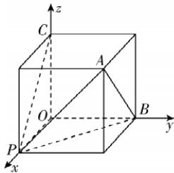

> [!faq]- 答案与解析
>
> > [!success]- **【答案】** B
>
> > [!note]- **【解析】**
> > 把 $PA, PB, PC$ 放在正方体中，使得这三条线成为正方体的三条面思：由从同一点出发的三条射线两两夹角为 $60^{\circ}$ ，联想到正方体的面对角线对角线，则 $PA, PB, PC$ 的夹角均为 $60^{\circ}$ 。建立如图所示的空间直角坐标系，设正方体的棱长为1，则 $P(1,0,0), C(0,0,1), A(1,1,1), B(0,1,0)$ ，所以 $\overrightarrow{PC} = (-1,0,1), \overrightarrow{PA} = (0,1,$
> >
> > 1), $\overrightarrow{PB}=(-1,1,0)$ ,
> > 设平面 PAB 的法向量为 $\boldsymbol{n}=(x,y,z)$ ,
> > 则 $\left\{\begin{aligned}\boldsymbol{n}\cdot\overrightarrow{PA}&=y+z=0,\\ \boldsymbol{n}\cdot\overrightarrow{PB}&=-x+y=0,\end{aligned}\right.$ 令 x=1，则 y=1,z=-1，所以 $\boldsymbol{n}=(1,1,-1)$ ，
> > 所以 $\cos\langle\overrightarrow{PC},\boldsymbol{n}\rangle=\frac{\overrightarrow{PC}\cdot\boldsymbol{n}}{|\overrightarrow{PC}||\boldsymbol{n}|}=$ $\frac{-2}{\sqrt{2}\times\sqrt{3}}=-\frac{\sqrt{6}}{3}.$ 设直线 PC 与平面 PAB 所成角为 $\theta$ ， $\theta\in\left[0,\frac{\pi}{2}\right]$ ，则 $\sin\theta=|\cos\langle\overrightarrow{PC},\boldsymbol{n}\rangle|=\frac{\sqrt{6}}{3}$ ，所以 $\cos\theta=\sqrt{1-\sin^{2}\theta}=\frac{\sqrt{3}}{3}$ . 故选 B.
> >
> > 
> >
> > 名师点拨 本题将 $PA, PB, PC$ 三条射线截取出来放在正方体中进行分析, 建系, 再利用空间向量法使问题得以简单求解.
