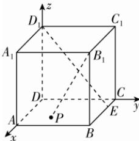

> [!faq]- 答案与解析
>
> > [!success]- **【答案】** $\sqrt{22}$
>
> > [!note]- **【解析】**
> > 如图, 以 D 为坐标原点, DA, DC, $DD_{1}$ 所在直线分别为 x, y, z 轴, 建立空间直角坐标系.
> >
> > 
> >
> > 则 $D_{1}(0,0,3),E(1,3,0),B_{1}(3,3,$ 3)，则 $\overrightarrow{D_1E} = (1,3, - 3)$ .设 $P(x,y,$ 0）， $x,y\in [0,3]$ ，则 $\overrightarrow{B_1P} = (x - 3,y-$ 3，-3).因为 $B_{1}P\bot D_{1}E$ ，所以 $\overrightarrow{B_1P}\cdot$ $\overrightarrow{D_1E} = x + 3y - 3 = 0$ ，即 $x = 3 - 3y$ ，所以
> >
> > $0 \leqslant 3 - 3y \leqslant 3$ ，得 $y \in [0,1]$ 。
> >
> > 点悟：根据点 $P$ 的运动范围求出纵坐标 $y$ 的取值范围，将长度最值问题转化为二次函数最值问题 $|\overrightarrow{B_1P}| = \sqrt{(x-3)^2 + (y-3)^2 + 9} = \sqrt{10y^2 - 6y + 18}$ ，而 $t = 10y^2 - 6y + 18 = 10\left(y - \frac{3}{10}\right)^2 + 18 - \frac{9}{10}$ ，由二次函数的单调性可知当 $y = 1$ 时， $t_{\max} = 22$ ，则 $|\overrightarrow{B_1P}|_{\max} = \sqrt{22}$ 。
