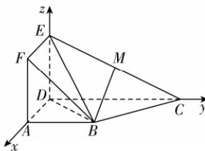

> [!faq]- 答案与解析
>
> > [!success]- **【答案】** 证明见解析
>
> > [!note]- **【解析】**
> > (1)根据题意可知平面 $ADEF \perp$ 平面ABCD,平面 $ADEF \cap$ 平面 $ABCD = AD$ ,又四边形 $ADEF$ 是正方形,所以 $AD \perp ED$ .因为 $ED \subset$ 平面 $ADEF$ ,所以 $ED \perp$ 平面 $ABCD$ ,从而可得 $\overrightarrow{DA}$ , $\overrightarrow{DC},\overrightarrow{DE}$ 两两垂直.以 $D$ 为原点,以 $\overrightarrow{DA},\overrightarrow{DC},\overrightarrow{DE}$ 的方向分别为 $x$ 轴、 $y$ 轴、 $z$ 轴的正方向建立如图所示的空间直角坐标系.则 $D(0,0,0)$ , $A(2,0,0),B(2,2,0),C(0,4,0)$ , $E(0,0,2),F(2,0,2)$ .又 $M$ 为 $CE$ 的中点,所以 $M(0,2,1)$ ,则 $\overrightarrow{BM}=(-2,0,1)$ ,且易知平面 $ADEF$ 的一个法向量为 $n=(0,1,0)$ ,因为 $n\cdot\overrightarrow{BM}=0$ ,所以 $n\perp\overrightarrow{BM}$ .又 $BM\not\subset$ 平面 $ADEF$ ,所以 $BM//$ 平面 $ADEF$ .(2)由(1)可得 $\overrightarrow{BC}=(-2,2,0),\overrightarrow{DB}=(2,2,0),\overrightarrow{DE}=(0,0,2)$ ,所以 $\overrightarrow{BC}\cdot\overrightarrow{DB}=-4+4=0,\overrightarrow{BC}\cdot\overrightarrow{DE}=0$ ,所以 $BC\perp DB,BC\perp DE$ .又 $DB\cap DE=D,DB,DE\subset$ 平面 $BDE$ ,所以 $BC\perp$ 平面 $BDE$ .
> >
> > 
