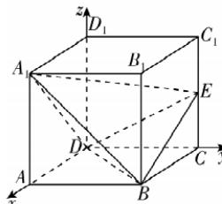

> [!faq]- 答案与解析
>
> > [!success]- **【答案】** 证明见解析
>
> > [!note]- **【解析】**
> > (1) 以 $D$ 为坐标原点, $DA$ , $DC$ , $DD_{1}$ 所在直线分别为 $x, y, z$ 轴, 建立空间直角坐标系, 如图所示.
> >
> > 
> >
> > 设正方体 $ABCD-A_{1}B_{1}C_{1}D_{1}$ 的棱长为 a，则 $D(0,0,0)$ ， $B(a,a,0)$ ， $C(0,a,0)$ ， $A_{1}(a,0,a)$ ， $C_{1}(0,a,a)$ ，则 $\overrightarrow{BD}=(-a,-a,0)$ .
> >
> > 设 $E(0,a,t)$ $(0\leqslant t\leqslant a)$ ，则 $\overrightarrow{A_1E} =$ $(-a,a,t - a)$ $\because \overrightarrow{A_1E}\cdot \overrightarrow{BD} = a^2 -a^2 +(t - a)\cdot 0 = 0,$ $\therefore \overrightarrow{A_1E}\bot \overrightarrow{BD}$ ，即 $A_{1}E\bot BD.$ (2)由（1）知， $\overrightarrow{DB} = (a,a,0),\overrightarrow{DA_1} =$ $(a,0,a),\overrightarrow{DE} = (0,a,t).$ 设平面 $A_{1}BD$ 的法向量为 $\pmb {n}_1 = (x_1,$ $y_{1},z_{1})$ 则 $\left\{ \begin{array}{l}\pmb{n}_{1}\cdot \overrightarrow{DB} = 0,\\ \pmb{n}_{1}\cdot \overrightarrow{DA_{1}} = 0, \end{array} \right.$ 即 $\left\{ \begin{array}{l}ax_1 + ay_1 = 0,\\ ax_1 + az_1 = 0, \end{array} \right.$ 令 $x_{1} = 1$ ，则 $y_{1} = z_{1} = -1$ ，则 $\pmb{n}_{1} =$ $(1, - 1, - 1)$ 设平面EBD的法向量为 $\pmb {n}_2 = (x_2,$ $y_{2},z_{2})$ ，则 $\left\{ \begin{array}{l}\pmb{n}_2\cdot \overrightarrow{DB} = 0,\\ \pmb{n}_2\cdot \overrightarrow{DE} = 0, \end{array} \right.$ 即 $\left\{ \begin{array}{l}ax_2 + ay_2 = 0,\\ ay_2 + tz_2 = 0, \end{array} \right.$ 令 $x_{2} = t$ ，则 $y_{2} = -t,$ $z_{2} = a$ ，则 $\pmb {n}_2 = (t, - t,a)$ 由平面 $A_{1}BD\perp$ 平面EBD，得 $\pmb {n}_1\perp \pmb{n}_2$ $\therefore \pmb {n}_1\cdot \pmb {n}_2 = 0,\therefore t + t - a = 0,$ 即 $t = \frac{a}{2}$ ∴当平面 $A_{1}BD\perp$ 平面EBD时， $E$ 为 $CC_1$ 的中点.
