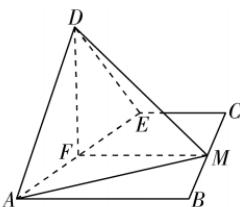
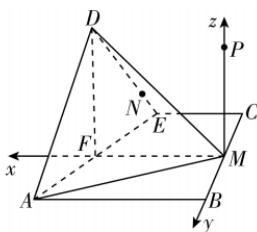

> [!faq]- 答案与解析
>
> > [!success]- **【答案】** 见解析
>
> > [!note]- **【解析】**
> > 如图, 取 AE 的中点 F, 连接 DF, MF.
> >
> > 
> >
> > 因为矩形 ABCD 中, AB = 4, AD = 2, E 为 CD 的中点, 所以 $CE \perp BC$ , $AD \perp DE$ , $DE = CE = \frac{1}{2}CD = 2$ , 则 AD = DE = 2, 所以 $DF \perp AE$ .
> > 又因为平面 ADE⊥平面 ABCE，平面 ADE∩平面 ABCE = AE, DF ⊂ 平面 ADE, 所以 DF⊥平面 ABCE. 因为 BC⊂平面 ABCE, 所以 DF⊥BC. 由 M, F 分别为 BC, AE 的中点, 得 MF 为梯形 ABCE 的中位线, 即 MF∥CE, 又 CE⊥BC, 所以 MF⊥BC. 因为 MF, DF⊂平面 DFM, MF∩DF=F, 所以 BC⊥平面 DFM,
> > 由 DM⊂平面 DFM,所以 BC⊥DM.
> > (2)【解】存在点 N,使得 CN//平面 ADM,此时 $\frac{EN}{ND}=\frac{1}{2}$ .证明如下:
> > 如图, 过点 M 作 MP⊥平面 ABCE, 以 M 为原点, MF, MB, MP 所在直线分别为 x, y, z 轴, 建立空间直角坐标系.
> >
> > 
> >
> > 由(1)得, $MF$ 为梯形 $ABCE$ 的中位线, 所以 $MF = 3$ .
> >
> > 由 $AD \perp DE$ , 得 $AE = \sqrt{AD^2 + DE^2} = 2\sqrt{2}$ , 则 $AF = EF = DF = \sqrt{2}$ ,
> >
> > 所以 $M(0,0,0), A(4,1,0), D(3,0,\sqrt{2}), E(2,-1,0), C(0,-1,0)$ , 则 $\overrightarrow{MA} = (4,1,0), \overrightarrow{MD} = (3,0,\sqrt{2}), \overrightarrow{DE} = (-1,-1,-\sqrt{2})$ ,
> >
> > 设平面 $ADM$ 的法向量为 $\boldsymbol{n} = (x,y,z)$ , 则 $\left\{\begin{array}{l}\boldsymbol{n} \cdot \overrightarrow{MA} = 0, \\ \boldsymbol{n} \cdot \overrightarrow{MD} = 0,\end{array}\right.$ 即 $\left\{\begin{array}{l}4x + y = 0, \\ 3x + \sqrt{2}z = 0,\end{array}\right.$ 取 $x = 2$ , 则 $\boldsymbol{n} = (2,-8,-3\sqrt{2})$ .
> >
> > 设 $\overrightarrow{DN} = \lambda \overrightarrow{DE} = (-\lambda,-\lambda,-\sqrt{2}\lambda), \lambda \in (0,1)$ , 所以 $N(3-\lambda,-\lambda,\sqrt{2}-\sqrt{2}\lambda)$ , 所以 $\overrightarrow{CN} = (3-\lambda,1-\lambda,\sqrt{2}-\sqrt{2}\lambda)$ .
> >
> > 由 $CN//$ 平面 $ADM$ 得 $\overrightarrow{CN} \perp \boldsymbol{n}$ , 所以 $\overrightarrow{CN} \cdot \boldsymbol{n} = 0$ , 即 $2(3-\lambda)-8(1-\lambda)-3\sqrt{2}(\sqrt{2}-\sqrt{2}\lambda)=-8+12\lambda=0$ , 解得 $\lambda=\frac{2}{3}$ ,
> >
> > 即 $DN=\frac{2}{3}DE$ , 所以 $\frac{EN}{ND}=\frac{1}{2}$ , 所以存在点 $N$ , 使得 $CN//$ 平面 $ADM$ , 此时 $\frac{EN}{ND}=\frac{1}{2}$ .
> >
> > 链接教材 本题是教材第31页练习第2题的变式与延伸,考查点的存在性问题时,先建立空间直角坐标系,引入参数表示该点坐标,再根据题目条件列出关于参数的方程.若方程有解,则点存在并可确定位置;若无解,则点不存在.
