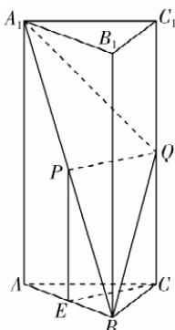
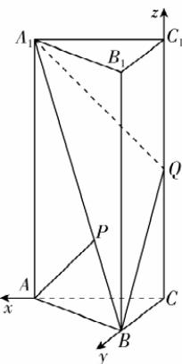

> [!faq]- 答案与解析
>
> > [!success]- **【答案】** 见解析
>
> > [!note]- **【解析】**
> > 设线段 AB 的中点为 E，连接 PE, CE，
> > 因为 P 为线段 $A_{1}B$ 的中点，Q 为棱 $C_{1}C$ 的中点，所以 $PE \parallel A_{1}A, PE = \frac{1}{2}A_{1}A, QC = \frac{1}{2}C_{1}C,$ 在直三棱柱 $ABC-A_{1}B_{1}C_{1}$ 中， $A_{1}A \parallel C_{1}C, A_{1}A = C_{1}C,$ 所以 $A_{1}A \parallel QC,$ 且 $\frac{1}{2}A_{1}A=QC,$ 则 $PE \parallel QC, PE = QC,$ 所以四边形 PECQ 为平行四边形，则 PQ//EC. 又 PQ∉平面 ABC, EC⊂平面 ABC, 所以 PQ//平面 ABC.
> > 又平面 $A_{1}BQ \cap$ 平面 ABC = l, $PQ \subset$ 平面 $A_{1}BQ$ ，所以 $PQ \parallel l$ .
> >
> > 
> >
> > (2)【解】存在点 P，使得 $AP \perp$ 平面 $A_{1}BQ$ ，此时 $\lambda = \frac{1}{3}$ 。在直三棱柱 $ABC - A_{1}B_{1}C_{1}$ 中， $CC_{1} \perp$ 平面 ABC， $BC \perp AC$ ，则 CA, CB, $CC_{1}$ 两两垂直，故以 C 为原点，CA, CB, $CC_{1}$ 所在直线分别为 x, y, z 轴建立空间直角坐标系，如图所示。
> > 因为 $CA = CB = \frac{1}{2} AA_{1} = 1$ ，所以 $B(0,1,0)$ , $Q(0,0,1)$ , $A_{1}(1,0,2)$ , $A(1,0,0)$ ,
> > 则 $\overrightarrow{BA_{1}}=(1,-1,2),\overrightarrow{A_{1}Q}=(-1,0,-1),\overrightarrow{AB}=(-1,1,0)$ .
> > 又 $\overrightarrow{BP}=\lambda\overrightarrow{BA_{1}}(0\leqslant\lambda\leqslant1)$ ，则 $\overrightarrow{BP}=(\lambda,-\lambda,2\lambda)$ ，所以 $\overrightarrow{AP}=\overrightarrow{AB}+\overrightarrow{BP}=(\lambda-1,1-\lambda,2\lambda)$ .
> > 若 $AP \perp$ 平面 $A_{1}BQ$ ,
> > 则 $\left\{\begin{aligned}\overrightarrow{AP}\cdot\overrightarrow{BA_{1}}=0,\\ \overrightarrow{AP}\cdot\overrightarrow{A_{1}Q}=0,\end{aligned}\right.$ 则 $\left\{\begin{aligned}\lambda-1-(1-\lambda)+4\lambda=0,\\-(\lambda-1)-2\lambda=0,\end{aligned}\right.$ 解得 $\lambda=\frac{1}{3}$ .
> > 所以线段 $A_{1}B$ 上存在点 P，使得 $AP \perp$ 平面 $A_{1}BQ$ ，此时 $\lambda=\frac{1}{3}$ .
> >
> > 
