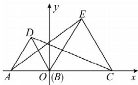

> [!faq]- 答案与解析
>
> > [!success]- **【答案】** 证明见解析
>
> > [!note]- **【解析】**
> > 如图,以点 B 为坐标原点,取 AC 所在直线为 x 轴,建立平面直角坐标系 xOy.
> >
> > 
> >
> > 设 $\triangle ABD$ 和 $\triangle BCE$ 的边长分别为a和c，则 $A(-a,0),C(c,0),E\left(\frac{c}{2},\frac{\sqrt{3}c}{2}\right),D\left(-\frac{a}{2},\frac{\sqrt{3}a}{2}\right)$ ,
> >
> > 由两点间距离公式, 得 $\left|AE\right|=\sqrt{\left(\frac{c}{2}+a\right)^{2}+\left(\frac{\sqrt{3}c}{2}-0\right)^{2}}=$ $\sqrt{a^{2}+ac+c^{2}}$ , $\left|CD\right|=\sqrt{\left(c+\frac{a}{2}\right)^{2}+\left(0-\frac{\sqrt{3}a}{2}\right)^{2}}=\sqrt{a^{2}+ac+c^{2}}$ 所以 $\left|AE\right|=\left|CD\right|$ .
> >
> > ## 2.3.3 点到直线的距离公式 2.3.4 两条平行直线间的距离
