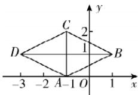

> [!faq]- 答案与解析
>
> > [!success]- **【答案】** 见解析
>
> > [!note]- **【解析】**
> > (1) 因为菱形 ABCD 中 BD 与 x 轴平行, $D(-3,1)$ , 所以可设 $B(x,1)$ . 由 $|AB| = |AD|$ , $|AD| = \sqrt{(-3+1)^{2} + (1-0)^{2}} = \sqrt{5}$ , 得 $|AB| =$ $\sqrt{(x+1)^{2}+(1-0)^{2}}=\sqrt{5}$ ，解得 x=1 或 x=-3（此时点 B 与点 D 重合，舍去），即 $B(1,1)$ 。又 $\overrightarrow{AB}=(2,1)$ ，且 $\overrightarrow{DC}=\overrightarrow{AB}$ ，所以 $\overrightarrow{OC}=\overrightarrow{OD}+\overrightarrow{DC}=\overrightarrow{OD}+\overrightarrow{AB}=(-3,1)+(2,1)=(-1,2)$ ，即 $C(-1,2)$ 。所以直线 DC 的斜率 $k=\frac{2-1}{-1-(-3)}=\frac{1}{2}$ ，所以直线 DC 的方程为 $y-1=\frac{1}{2}(x+3)$ ，即 $y=\frac{1}{2}x+\frac{5}{2}$ 。因此直线 DC 在 y 轴上的截距为 $\frac{5}{2}$ 。
> >
> > 
> >
> > (2)已知 $A(-1,0),D(-3,1)$ ，则直线 $AD$ 的斜率为 $\frac{1 - 0}{-3 - (-1)} = -\frac{1}{2}$ ，所以直线 $AD$ 的方程为 $y - 0 = -\frac{1}{2} (x + 1)$ ，即 $x+$ $2y + 1 = 0.$ 由（1）知 $B(1,1),C(-1,$ 2)，则直线 $BC$ 的斜率为 $\frac{2 - 1}{-1 - 1} =$ $-\frac{1}{2}$ 所以直线 $BC$ 的方程为 $y - 1 =$ $-\frac{1}{2} (x - 1)$ ，即 $x + 2y - 3 = 0.$ 根据平行直线间的距离公式，知边 $AD$ 与边 $BC$ 所在直线之间的距离为 $\frac{|1 - (-3)|}{\sqrt{1^2 + 2^2}} =$ $\frac{4\sqrt{5}}{5}.$
> >
> > ## 刷易错
> >
> > ## ★ 易错点 处理距离的综合问题时分类讨论不全致误
