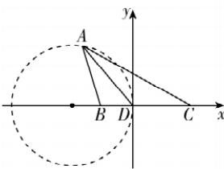

> [!faq]- 答案与解析
>
> > [!success]- **【答案】** C
>
> > [!note]- **【解析】**
> > 如图所示，圆心 $C(5,0)$ ，连接 $CP, CA$ ，因为直线 $l_1, l_2$ 关于直线 $y = x - 1$ 对称，所以 $CP$ 垂直于直线 $y = x - 1$ ，故 $|CP| = \frac{|5 - 1|}{\sqrt{2}} = 2\sqrt{2}$ ，而 $|AC| = \sqrt{2}$ ，则 $|PA| = \sqrt{|CP|^2 - |CA|^2} =$ $(-4,0),(0,0)$ .
> > 故当点 A 的纵坐标的绝对值最大，即 $A(-2,\pm2)$ 时， $\triangle ABC$ 的面积取得最大值，最大值为 $S_{\triangle ABC}=\frac{1}{2}\times3\times2=3$ . 故选 C.
> >
> > 
