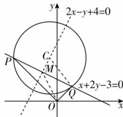

> [!faq]- 答案与解析
>
> > [!success]- **【答案】** C
>
> > [!note]- **【解析】**
> > 由 $x^{2}+y^{2}+x-6y+m=0$ ，得 $\left(x+\frac{1}{2}\right)^{2}+(y-3)^{2}=\frac{37}{4}-m$ ，所以圆心为 $C\left(-\frac{1}{2},3\right)$ ，半径为 $r=\sqrt{\frac{37}{4}-m}$ ，取 PQ 的中点 M，连接 OM, CM, CQ，则 $CM \perp PQ$ ，又直线 $x+2y-3=0$ 的斜率为 $-\frac{1}{2}$ ，所以直线 CM 的方程为 $y-3=2\left(x+\frac{1}{2}\right)$ ，即 $2x-y+4=0$ ，由 $\left\{\begin{aligned}&x+2y-3=0,\\ &2x-y+4=0,\end{aligned}\right.$ 解得 $\left\{\begin{aligned}&x=-1,\\ &y=2,\end{aligned}\right.$ 则 $M(-1,2)$ ，故 $|CM|= \sqrt{\left(-\frac{1}{2}+1\right)^{2}+(3-2)^{2}}=\frac{\sqrt{5}}{2}$ ， $|OM|=\sqrt{1+4}=\sqrt{5}$ ，由 $\overrightarrow{OP} \cdot \overrightarrow{OQ}=0$ ，知 $OP \perp OQ$ ，所以 $|MQ|=|MO|=\sqrt{5}$ ，在 Rt△CMQ 中，由 $|CQ|=r=$ $\sqrt{|CM|^{2}+|MQ|^{2}}$ ，得 $5+\frac{5}{4}=\frac{37}{4}-m$ ，解得 m=3。故选 C.
> >
> > 
> >
> > 多种解法 设 $P(x_{1}, y_{1})$ , $Q(x_{2}, y_{2})$ , 由 $\overrightarrow{OP} \cdot \overrightarrow{OQ} = 0$ , 知 $x_{1}x_{2} + y_{1}y_{2} = 0$ . 又 $x_{1} = 3 - 2y_{1}$ , $x_{2} = 3 - 2y_{2}$ , 所以 $(3 - 2y_{1})(3 - 2y_{2}) + y_{1}y_{2} = 0$ , 即 $5y_{1}y_{2} - 6(y_{1} + y_{2}) + 9 = 0$ ①.
> > 由 $\left\{\begin{aligned}&x+2y-3=0,\\&x^{2}+y^{2}+x-6y+m=0,\end{aligned}\right.$ 消去 x 得 $5y^{2}-20y+12+m=0,\Delta=160-20m>0,$ 即 m<8, 所以 $y_{1}+y_{2}=4,y_{1}y_{2}=\frac{12+m}{5}$ , 代入①式得 $12+m-6\times4+9=0$ , 解得 m=3. 故选 C.
> >
> > 名师点拨 解决直线与圆相交问题时,常采用将直线与圆的方程联立,设出两个交点的坐标并用根与系数的关系表示,然后整体代入求解的这种“设而不求”的方法.
