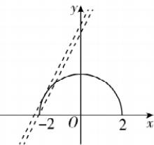

> [!faq]- 答案与解析
>
> > [!success]- **【答案】** $[4,2\sqrt{5})$
>
> > [!note]- **【解析】**
> > 由题意知，曲线 $y = \sqrt{4 - x^2}$ 可化为 $x^{2} + y^{2} = 4(y\geqslant$ 0)，则曲线 $E$ 表示以(0,0)为圆心，半径 $r = 2$ 的半圆，且 $y\geqslant 0$ 当直线 $y = 2x + b(b\geqslant 0)$ 与半圆相切时，可得 $\frac{|b|}{\sqrt{2^2 + (-1)^2}} = 2$ ，解得 $b =$ $2\sqrt{5}$ 或 $b = -2\sqrt{5}$ （舍去），因为直线 $y = 2x + b$ 与曲线 $y = \sqrt{4 - x^2}$ 恰有两个公共点，如图所示，当直线 $y = 2x + b$ 经过（-2,0）时为临界情况，此时 $b = 4$ 所以当 $4\leqslant b <   2\sqrt{5}$ 时，直线 $y = 2x + b$ 与曲线 $y = \sqrt{4 - x^2}$ 恰有两个公共点.
> >
> > 
