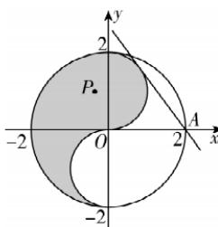

> [!faq]- 答案与解析
>
> > [!success]- **【答案】** C
>
> > [!note]- **【解析】**
> > 记 $A(2,0)$ , 则 $k = \frac{y}{x - 2}$ 为直线 $AP$ 的斜率, 故当直线 $AP$ 与半 $\rightarrow$ 敲黑板: 看到形如 $\frac{y - b}{x - a}$ 的式子可考虑将其转化为直线的斜率来求解
> >
> > 圆 $x^{2} + (y - 1)^{2} = 1, x > 0$ 相切时, 斜率 $k$ 最小, 设 $l_{AP}: y = k(x - 2), k < 0$ , 则 $\frac{|-1 - 2k|}{\sqrt{k^2 + 1}} = 1$ , 解得 $k = -\frac{4}{3}$ 或 $k = 0$ (舍去), 即 $\frac{y}{x - 2}$ 的最小值为 $-\frac{4}{3}$ . 故选 C.
> >
> > 
