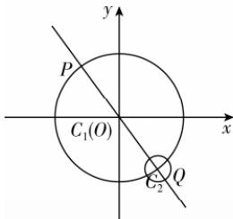
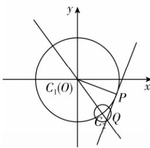

> [!faq]- 答案与解析
>
> > [!success]- **【答案】** ACD
>
> > [!note]- **【解析】**
> > 对于A,由圆 $C_1$ 的方程知,圆心 $C_1(0,0)$ ,半径 $r_1 = 5$ ; 圆 $C_2$ 的方程化成标准方程为 $(x - 3)^2 + (y + 4)^2 = 1$ , 所以圆心 $C_2(3,-4)$ ,半径 $r_2 = 1$ . 因为两圆圆心距 $|C_1C_2| = \sqrt{(3 - 0)^2 + (-4 - 0)^2} = 5$ ,且 $r_1 - r_2 < |C_1C_2| < r_1 + r_2$ , 所以圆 $C_1$ 与圆 $C_2$ 相交,故A正确. 对于B,如图①所示,
> >
> >   
> > 图①
> >
> > 当线段 PQ 同时经过两圆圆心且点 P, Q 分别在两圆圆心两侧时， $|PQ|$ 取得最大值， $|PQ|_{\max} = |C_1 C_2| + r_1 + r_2 = 5 + 5 + 1 = 11$ ，故 B 错误.
> > 对于 C，两圆方程作差，得两圆公共弦所在直线方程为 6x-8y-49=0，
> > 又圆心 $C_{1}$ 到直线 6x-8y-49=0 的距离 $d=\frac{|-49|}{\sqrt{6^{2}+(-8)^{2}}}=\frac{49}{10}$ 所以两圆的公共弦长为 $2\sqrt{r_{1}^{2}-d^{2}}=$ 垂径定理 $2\sqrt{5^{2}-\left(\frac{49}{10}\right)^{2}}=\frac{3\sqrt{11}}{5}$ ，故 C 正确.
> >
> > 对于 D, 如图②所示,
> >
> >   
> > 图②
> >
> > 当直线 PQ 与圆 $C_{1}$ 相切时，点 Q 在圆 $C_{1}$ 外，
> > 因为 $\left|PQ\right|^{2}=\left|C_{1}Q\right|^{2}-r_{1}^{2}$ ，所以当 $\left|C_{1}Q\right|$ 取得最大值时， $\left|PQ\right|$ 取得最大值.
> > 因为 $\left|C_{1}C_{2}\right|=5$ ，所以点 $C_{2}$ 在圆 $C_{1}$ 上，所以 $\left|C_{1}Q\right|$ 的最大值为 $r_{1}+r_{2}=6$ ，
> > 所以 $\left|PQ\right|$ 的最大值为 $\sqrt{6^{2}-5^{2}}=\sqrt{11}$ ，故 D 正确. 故选 ACD.
