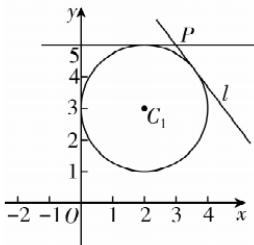

> [!faq]- 答案与解析
>
> > [!success]- **【答案】** 见解析
>
> > [!note]- **【解析】**
> > （1）圆 $C_{1}$ 的方程可化为 $(x-2)^{2}+(y-3)^{2}=4$ ,
> > 则圆心 $C_{1}(2,3)$ ，半径为 2，
> > 由 $(3-2)^{2}+(5-3)^{2}=5>4$ ，可知点P
> > 在圆 $C_{1}$ 的外部，作出圆 $C_{1}$ 及过点 P
> > 敲黑板：根据点与圆的位置，可判断切线条数
> > 的切线如图所示，
> >
> > 
> >
> > 由图可知，过点 $P$ 的切线 $l$ 的斜率存在，设 $l$ 的方程为 $y - 5 = k(x - 3)$ ，即 $kx - y + 5 - 3k = 0$ 则圆心 $C_1$ 到直线 $l$ 的距离为 $\frac{|2k - 3 + 5 - 3k|}{\sqrt{1 + k^2}} = 2$ ，解得 $k = 0$ 或 $k = -\frac{4}{3}$ 所以直线 $l$ 的方程为 $4x+$ $3y - 27 = 0$ 或 $y = 5.$ (2)由 $\left\{ \begin{array}{l}x^{2} + y^{2} - 4x - 6y + 9 = 0,\\ x^{2} + y^{2} + 2x - 4y - 4 = 0, \end{array} \right.$ 两式相减得直线 $AB$ 的方程为 $6x+$ $2y - 13 = 0,$ 则圆心 $C_1$ 到直线 $AB$ 的距离 $d =$ $\frac{|12 + 6 - 13|}{\sqrt{40}} = \frac{\sqrt{10}}{4}$ ，所以 $|AB| =$ $2\sqrt{4 - d^2} = \frac{3\sqrt{6}}{2}.$
