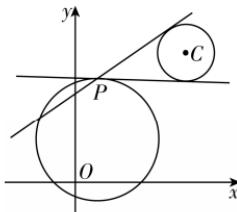

> [!faq]- 答案与解析
>
> > [!success]- **【答案】** B
>
> > [!note]- **【解析】**
> > 设 $P(x,y)$ ，由 $\overrightarrow{PO} \cdot \overrightarrow{PA} = 3$ ，得 $(-x, -y) \cdot (2 - x, 4 - y) = 3$ ，故 $x(x - 2) + y(y - 4) = 3$ ，
> >
> > 即 $(x - 1)^2 +(y - 2)^2 = 8$ ，故点 $P$ 的轨迹为以(1,2)为圆心， $2\sqrt{2}$ 为半径的圆.又点 $C(5,6)$ 与圆心(1,2)的距离为 $d = \sqrt{(5 - 1)^2 + (6 - 2)^2} = 4\sqrt{2}$ ，由于过点 $P$ 总可以向以点 $C(5,6)$ 为圆心的圆作两条切线，故两圆外离，所以 $0 < r < 4\sqrt{2} -2\sqrt{2}$ ，故 $r$ 的取值范围为 $(0,2\sqrt{2})$ .故选B.
> >
> > 
