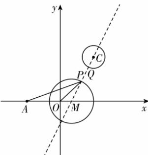

> [!faq]- 答案与解析
>
> > [!success]- **【答案】** $4\sqrt{5} - 5$
>
> > [!note]- **【解析】**
> > 设 $P(x, y)$ ，由 $\frac{|PA|}{|PO|} = 2$ 得 $\frac{\sqrt{(x + 3)^2 + y^2}}{\sqrt{x^2 + y^2}} = 2$ ，整理得 $(x - 1)^2 + y^2 = 4$
> >
> > 设该圆的圆心为 M，则 $M(1,0)$ ，半径为 2.
> >
> > 
> >
> > 易知 $C(3,4)$ ，圆 $C$ 的半径为 1， $|CM| = \sqrt{4 + 16} = 2\sqrt{5} > 3 = 1 + 2$ 故圆 $M$ 与圆 $C$ 相离，故 $|PQ|$ 的最小值为 $2\sqrt{5} - 3$ ，当且仅当 $M, P, Q, C$ 共线且 $P, Q$ 在线段 $MC$ 上时取最小值，此时 $|PC|$ 也取得最小值，最小值为 $|CM| - 2 = 2\sqrt{5} - 2$ 故 $|PQ| + |PC|$ 的最小值为 $4\sqrt{5} - 5$ .
