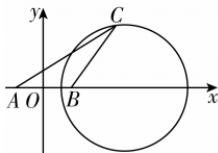

> [!faq]- 答案与解析
>
> > [!success]- **【答案】** D
>
> > [!note]- **【解析】**
> > 设 $C(x, y)$ ，由 $|CA| =$ 此时点 P 在以 $O_{2}\left(\frac{1}{1-k^{2}},\frac{1}{1-k^{2}}\right)$ 为圆心，半径为 $r_{2}=\frac{\sqrt{2}k}{|1-k^{2}|}$ 的圆 $O_{2}$ 上。
> > 要使这样的点 P 存在，则圆 $O_{1}$ 与圆 $O_{2}$ 要有交点。
> > → 敲 黑板：将线段比例问题转化为圆与圆相交问题是本题的解题关键
> > 当 k=2 时， $O_{2}\left(-\frac{1}{3},-\frac{1}{3}\right),r_{2}=\frac{2\sqrt{2}}{3}$ 此时 $\frac{2\sqrt{2}-2}{3}<|O_{1}O_{2}|=\frac{1}{3}<\frac{2\sqrt{2}+2}{3}$ ，故 k=2 符合题意；
> >
> > 专题4 与圆有关的轨迹问题 $\sqrt{2}|CB|$ ，得 $\sqrt{(x + 2)^2 + y^2} = \sqrt{2} \times \sqrt{(x - 2)^2 + y^2}$ ，化简整理得 $x^2 + y^2 - 12x + 4 = 0$ ，即 $(x - 6)^2 + y^2 = 32$ ，即点 $C$ 的轨迹为以(6,0)为圆心， $4\sqrt{2}$ 为半径的圆。因为 $|AB| = 4$ ，所以当 $AB$ 边上高最大时， $\triangle ABC$ 的面积最大，所以 $(S_{\triangle ABC})_{\max} = \frac{1}{2}|AB| \cdot r = \frac{1}{2} \times 4 \times 4\sqrt{2} = 8\sqrt{2}$ 。故选D.
> >
> > 
