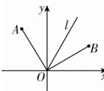

> [!faq]- 答案与解析
>
> > [!success]- **【答案】** $\sqrt{3}$
>
> > [!note]- **【解析】**
> > 因为 $A(-1, \sqrt{3})$ ，所以 $k_{OA} = -\sqrt{3}$ . 因为点 $B$ 在第一象限，且
> >
> > 
> >
> > $OB \perp OA$ ，所以 $k_{OB} = \frac{\sqrt{3}}{3}$ ，所以直线 $OB$ 的倾斜角为 $\frac{\pi}{6}$ ，所以 $\angle BOy = \frac{\pi}{3}$ 设 $\angle BOy$ 的平分线所在直线为直线 $l$ ，则直线 $l$ 的倾斜角为 $\frac{\pi}{3}$ ，所以 $k_{l} =$ $\tan \frac{\pi}{3} = \sqrt{3}$ ，即 $\angle BOy$ 的平分线所在直线的斜率为 $\sqrt{3}$
