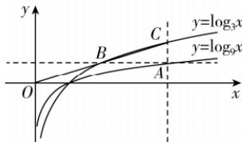

> [!faq]- 答案与解析
>
> > [!success]- **【答案】** $\frac{\log_32}{2}$
>
> > [!note]- **【解析】**
> > 不妨设 $A(x_0, \frac{1}{2}\log_3x_0), x_0 > 0$ ，则 $B(\sqrt{x_0}, \frac{1}{2}\log_3x_0), C(x_0, \log_3x_0)$ ，由题意可得 $k_{BO} = k_{OC} \Rightarrow \frac{\log_3x_0}{x_0} = \frac{\frac{1}{2}\log_3x_0}{\sqrt{x_0}}$ ，点悟：利用 $O, B, C$ 三点共线时斜率之间的关系求 $x_0$ 解得 $x_0 = 4$ 或 $x_0 = 1$ ，经过检验 $x_0 = 1$ 不符合题意，故舍去，故直线 $BC$ 的
> >
> > 斜率为 $\frac{\log_{3}4}{4}=\frac{\log_{3}2}{2}.$
> >
> > 
