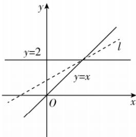

> [!faq]- 答案与解析
>
> > [!success]- **【答案】** ABD
>
> > [!note]- **【解析】**
> > A选项, $l:(2m + 1)\cdot x+$ $(1 - m)y - 2m - 4 = 0\Rightarrow m(2x - y - 2) + x+$ $y - 4 = 0$ ，令 $\left\{ \begin{array}{ll}2x - y - 2 = 0,\\ x + y - 4 = 0, \end{array} \right.$ 解得 $\left\{ \begin{array}{ll}x = 2,\\ y = 2, \end{array} \right.$ 故直线 $l$ 过定点(2,2),A正确；B选项，由A选项知，直线 $l$ 过定点 $E(2,2)$ ，故原点 $O$ 到直线 $l$ 距离的最大值为 $|OE| = \sqrt{2^2 + 2^2} = 2\sqrt{2},$ B正确；C选项，点 $A(-1,0),B(1,0)$ 到直线 $l$ 的距离相等, 则 $\frac{|-(2m+1)-2m-4|}{\sqrt{(2m+1)^{2}+(1-m)^{2}}}=\frac{|2m+1-2m-4|}{\sqrt{(2m+1)^{2}+(1-m)^{2}}},$ 故 $|-4m-5|=3$ , 解得 $m=-\frac{1}{2}$ 或 m=-2, C 错误; D 选项, 直线 $l:(2m+1)x+(1-m)y-2m-4=0$ 不经过第四象限, 当 $2m+1=0$ 时, 解得 $m=-\frac{1}{2}, l:y=2$ , 满足要求, 此时斜率为 0,
> >
> > 避坑：注意勿遗漏直线与 x 轴平行且在 x 轴上方的情况
> > 当 l 经过原点时，-2m-4=0，解得 m=-2，此时 l:y=x，斜率为 1。如图，数形结合得当 $0 \leqslant k_{l} \leqslant 1$ 时，满足要求，
> >
> > 
> >
> > 即 $\frac{2m+1}{m-1}\in[0,1]$ ，解得 $-2\leqslant m\leqslant$ $-\frac{1}{2}$ , D 正确. 故选 ABD.
> >
> > 归纳总结 解方程含有参数的直线恒过定点问题一般有两种方法, 方法一: 任给直线方程中的参数赋两个不同的值, 得到两条不同的直线, 这两条直线的交点就是题目中方程含参数直线所过的定点, 从而问题得解. 方法二: 含有一个参数的二元一次方程若能整理为 $A_{1}x + B_{1}y + C_{1} + \lambda (A_{2}x + B_{2}y + C_{2}) = 0$ , 其中 $\lambda$ 是参数, 这就说明了它表示的直线必过定点, 其定点可由方程组 $\left\{ \begin{array}{l} A_{1}x + B_{1}y + C_{1} = 0, \\ A_{2}x + B_{2}y + C_{2} = 0 \end{array} \right.$ 解得. 若整理成 $y - y_{0} = k(x - x_{0})$ 的形式, 则表示的所有直线必过定点 $(x_{0}, y_{0})$ .
