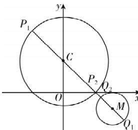

> [!faq]- 答案与解析
>
> > [!success]- **【答案】** 见解析
>
> > [!note]- **【解析】**
> > (1)因为圆 C 关于 y 轴对称, 所以圆心 C 在 y 轴上, 又圆心 C 在直线 $y = x + 2$ 上,
> > 所以圆心 C 为直线 $y = x + 2$ 与 y 轴的交点, 即 (0,2).
> > 又因为圆 C 与 x 轴相交的弦长为 4, 所以 $r = \sqrt{2^{2} + 2^{2}} = 2\sqrt{2}$ , 则圆 C 的方程为 $x^{2} + (y - 2)^{2} = 8$ .
> > (2) 设动点 $Q(x, y)$ ，因为动点 Q 与两个定点 $A(1, -1)$ , $B\left(\frac{5}{2}, -1\right)$ 的距离之比为 2，
> > 所以 $\frac{\sqrt{(x-1)^{2}+(y+1)^{2}}}{\sqrt{\left(x-\frac{5}{2}\right)^{2}+(y+1)^{2}}} = 2$ , 所以 $(x-1)^{2}+(y+1)^{2}=4\left[\left(x-\frac{5}{2}\right)^{2}+(y+1)\right]$
> >
> > $1)^{2}\Bigg],$ 化简得 $(x - 3)^{2} + (y + 1)^{2} = 1$ ，圆心为 $M(3, - 1)$ ，半径 $r_2 = 1$ 由(1)知圆 $C$ 的方程为 $x^{2} + (y - 2)^{2} =$ 8，圆心 $C(0,2)$ ，半径 $r = 2\sqrt{2}$ .两圆心的圆心距 $\mid MC\mid =$ $\sqrt{(3 - 0)^2 + (-1 - 2)^2} = 3\sqrt{2} >2\sqrt{2} +$ 1，所以两圆外离，如图， $\mid PQ\mid$ 的最大值为 $\mid MC\mid +r + r_2 =$ $3\sqrt{2} +2\sqrt{2} +1 = 5\sqrt{2} +1,$ 最小值为 $\mid MC\mid -r - r_2 = 3\sqrt{2} -2\sqrt{2} -1 =$ $\sqrt{2} -1.$
> >
> > 
