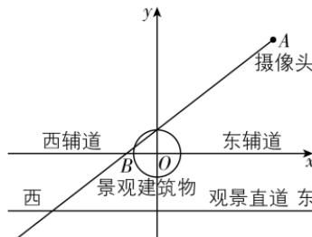
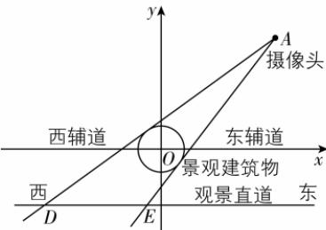

> [!faq]- 答案与解析
>
> > [!success]- **【答案】** 见解析
>
> > [!note]- **【解析】**
> > (1)以 O 为原点,正东方向为 x 轴正方向建立如图所示的平面直角坐标系,则 $O(0,0)$ , $A(20,20)$ , 观景直道所在直线的方程为 y=-10,依题意得,游客所在点为 $B(-5,0)$ , 则直线 AB 的方程为 $\frac{y}{20}=\frac{x+5}{20+5}$ , 化简得 $4x-5y+20=0$ , 所以圆心 O 到直线 AB 的距离 $d_{1}=\frac{|20|}{\sqrt{4^{2}+5^{2}}}=\frac{20}{\sqrt{41}}<4$ , 故直线 AB 与圆 O 相交,所以此处的游客不在该摄像头的监控范围内.
> >
> > 
> >
> > (2)由图易知:过点 A 的直线 l 与圆 O 相切或相离时,摄像头监控不会被建筑物遮挡,
> > 所以设直线 l 过 A 且恰与圆 O 相切,
> > ①若直线 l 的斜率不存在,即 l 的方程为 x=20,则 l 不可能与圆 O 相切;
> > ②若直线 l 的斜率存在,设 l:y-20=
> >
> > → 进坑：设直线 l 的点斜式方程前，需对 l 的斜率是否存在进行讨论 $k(x-20)$ ，整理得 $kx-y-20k+20=0$ ，所以圆心 O 到直线 l 的距离 $d_{2}=\frac{|-20k+20|}{\sqrt{k^{2}+1}}=4$ ，解得 $k=\frac{3}{4}$ 或 $k=\frac{4}{3}$ ，所以直线 l 的方程为 y-20=$\frac{3}{4}(x-20)$ 或 $y-20=\frac{4}{3}(x-20)$ ，即 $3x-4y+20=0$ 或 $4x-3y-20=0$ 。
> > 设这两条直线与直线 y=-10 分别交于点 D, E，由 $\left\{\begin{aligned}y&=-10,\\ 3x&-4y+20=0,\end{aligned}\right.$ 解得 x=-20，由 $\left\{\begin{aligned}y&=-10,\\ 4x&-3y-20=0,\end{aligned}\right.$ 解得 x=-2.5，所以 $|DE|=17.5$ ，故观景直道不在该摄像头的监控范围内的长度为 17.5 米。
> >
> > 
