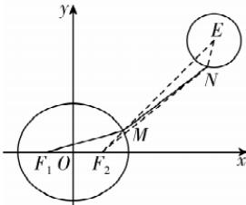

> [!faq]- 答案与解析
>
> > [!success]- **【答案】** B
>
> > [!note]- **【解析】**
> > 如图, 连接 $MF_{2}$ , EM, EN, $NF_{2}$ , M 为椭圆 C 上任意一点, 则 $|MF_{1}| + |MF_{2}| = 4$ ,
> > 又因为 N 为圆 $E:(x-5)^{2}+(y-4)^{2}=1$ 上任意一点，
> > 所以 $|MN| - |MF_{1}| = |MN| - (4 -$ $\mid MF_{2}\mid) = \mid MN\mid +\mid MF_{2}\mid -4\geqslant$ $\mid F_2N\mid -4\geqslant \mid EF_2\mid -5,$
> >
> > 点悟：利用三角形中两边之和大于第三边的性质
> > 当且仅当 M, N, E, $F_{2}$ 共线且点 M, N 在线段 $EF_{2}$ 上时等号成立.
> > 由题意知， $F_{2}(1,0)$ ， $E(5,4)$ ，则 $\left|EF_{2}\right|=\sqrt{(5-1)^{2}+(4-0)^{2}}=4\sqrt{2}$ ，
> > 所以 $\left|MN\right|-\left|MF_{1}\right|$ 的最小值为 $4\sqrt{2}-5$ . 故选 B.
> >
> > 
> >
> > 名师点拨 求 $\left|MN\right|+\left|MF_{2}\right|$ 的最值时, 可以利用定点 $F_{2}$ 和 E, 当 M, N, E, $F_{2}$ 共线且点 M, N 在线段 $EF_{2}$ 上时 $\left|MN\right|+\left|MF_{2}\right|$ 最小, 等于 $\left|EF_{2}\right|-\left|EN\right|$ .
