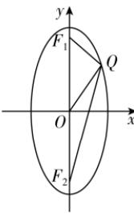

> [!faq]- 答案与解析
>
> > [!success]- **【答案】** 见解析
>
> > [!note]- **【解析】**
> > 由已知 $|QF_1| + |QF_2| = 2\sqrt{5}$ ，则 $2a = 2\sqrt{5}$ ，即 $a = \sqrt{5}$ ，又 $\triangle QF_1F_2$ 的周长为 $|QF_1| + |QF_2| + |F_1F_2| = 2\sqrt{5} + 4$ 得 $|F_1F_2| = 2c = 4$ ，则 $c = 2$ ，则 $b^2 = a^2 - c^2 = 1$ ，故椭圆 $C$ 的标准方程为 $\frac{y^2}{5} + x^2 = 1$ .
> >
> > (2)【证明】由(1)可知 $F_{1}(0,2)$ , $F_{2}(0,-2)$ , 设 $Q(x,y)$ ,
> > 则 $\overrightarrow{QF_{1}} = (-x, 2 - y)$ , $\overrightarrow{QF_{2}} = (-x, -2 - y)$ , $\overrightarrow{OQ} = (x, y)$ , $|\overrightarrow{QF_{1}}|^{2} + |\overrightarrow{QF_{2}}|^{2} =$
> >
> > 
> >
> > $x^{2} + (2 - y)^{2} + x^{2} + (-2 - y)^{2} = 2(x^{2} + y^{2}) + 8 = 2|\overrightarrow{OQ}|^{2} + 8,$ 又 $(|\overrightarrow{QF_1}| + |\overrightarrow{QF_2}|)^{2} = |\overrightarrow{QF_1}|^{2} + |\overrightarrow{QF_2}|^{2} + 2|\overrightarrow{QF_1}| \cdot |\overrightarrow{QF_2}| = 20$ ，即 $2|\overrightarrow{OQ}|^2 +8+$ $2|\overrightarrow{QF_1}| \cdot |\overrightarrow{QF_2}| = 20,$ 即 $|\overrightarrow{QF_1}| \cdot |\overrightarrow{QF_2}| + |\overrightarrow{OQ}|^2 = 6$ ，所以无论动点 $Q$ 在 $C$ 上如何运动， $|\overrightarrow{QF_1}| \cdot |\overrightarrow{QF_2}| + |\overrightarrow{OQ}|^2$ 恒为一个常数.
> >
> > ## 刷易错
> >
> > ★易错点 忽视焦点位置的分类讨论而致错
