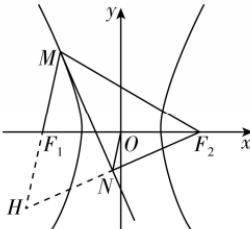

> [!faq]- 答案与解析
>
> > [!success]- **【答案】** B
>
> > [!note]- **【解析】**
> > 双曲线 $\frac{x^2}{4} -\frac{y^2}{12} = 1$ 的实半轴长 $a = 2$ ，延长 $F_{2}N,MF_{1}$ 交于点 $H$
> >
> > 
> >
> > 由题意可得 $|MH| = |MF_2|$ , $|NH| = |NF_2|$ .
> >
> > 又 O 是 $F_1F_2$ 的中点，
> >
> > 所以 $|ON| = \frac{1}{2} |F_1H| = \frac{1}{2} (|MH| - |MF_1|) = \frac{1}{2} (|MF_2| - |MF_1|) = a = 2$ , 故选 B.
