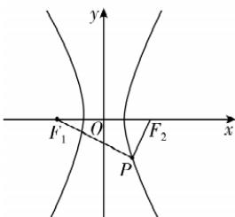

> [!faq]- 答案与解析
>
> > [!success]- **【答案】** A
>
> > [!note]- **【解析】**
> > 在 Rt△PF $_{1}$ F $_{2}$ 中，直线 PF $_{2}$ 的斜率为 2，故 PF $_{1}$ ⊥ PF $_{2}$ ，则 tan∠PF $_{2}$ F $_{1}$ = $\frac{|PF_{1}|}{|PF_{2}|}$ = 2，故 |PF $_{1}$ | = 2|PF $_{2}$ |. 又 |PF $_{1}$ | - |PF $_{2}$ | = 2a，所以$|PF_{1}|=4a,|PF_{2}|=2a.$ 由勾股定理得 $|F_{1}F_{2}|=\sqrt{4a^{2}+16a^{2}}=2\sqrt{5}a$ ，所以 $c=\sqrt{5}a$ 。又 $\triangle PF_{1}F_{2}$ 内切圆半径 $r_{1}=3-\sqrt{5}$ ，由三角形等面积法可得 $\frac{1}{2}\cdot2a\cdot4a=\frac{1}{2}(2a+4a+2\sqrt{5}a)r_{1}$ ，解得 a=1，故 $c=\sqrt{5},b^{2}=c^{2}-a^{2}=4$ ，故双曲线的方程为 $x^{2}-\frac{y^{2}}{4}=1$ 。故选 A.
> >
> > 
