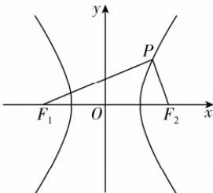

> [!faq]- 答案与解析
>
> > [!success]- **【答案】** B
>
> > [!note]- **【解析】**
> > 由题得 $S_{\triangle PF_{1}F_{2}}=\frac{1}{2}|PF_{1}|\cdot|PF_{2}|=4$ ，所以 $|PF_{1}|\cdot|PF_{2}|=8$ ，
> > 因为 $PF_{1} \perp PF_{2}$ ，所以 $|PF_{1}|^{2} + |PF_{2}|^{2} = (2c)^{2}$ ，
> > 则 $(|PF_{1}|-|PF_{2}|)^{2}+2|PF_{1}|\cdot|PF_{2}|=4c^{2}$ ，所以 $4a^{2}+16=4c^{2}$ ，即 $a^{2}+4=c^{2}$ .
> > 又 $c^{2}=a^{2}+b^{2}$ ，所以 $b^{2}=4$ ，即 b=2。故选 B.
> >
> > 
