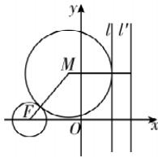

> [!faq]- 答案与解析
>
> > [!success]- **【答案】** B
>
> > [!note]- **【解析】**
> > 由图可知, 点 M 到点 F 的距离比到直线 l 的距离大 1, 记直线 x=3 为直线 $l'$ , 则点 M 到点 F 的距
> >
> > 
> >
> > 离等于点 M 到直线 $l'$ 的距离，由抛物线的定义可知，点 M 的轨迹为顶点在原点，且开口向左的抛物线，其中 p = 6，所以点 M 的轨迹方程为 $y^{2} = -12x$ ，故选 B.
