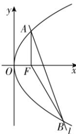

> [!faq]- 答案与解析
>
> > [!success]- **【答案】** D
>
> > [!note]- **【解析】**
> > 由题知,抛物线的焦点为 $F\left(\frac{p}{2},0\right)$ , 准线方程为 $x=-\frac{p}{2}$ . 因为点 A 在 F 的正上方, 所以点 A 的坐标为 $\left(\frac{p}{2},p\right)$ .
> >
> > 
> >
> > 因为 $\angle AFB$ 为钝角，所以点 $B$ 在 $x$ 轴下方，  
> > 所以 $x_{B} + \frac{p}{2} = |BF| = 2|AF| = 2p$ ，解得 $x_{B} = \frac{3}{2} p$ ，即点 $B$ 的坐标为 $\left(\frac{3p}{2},\sqrt{3} p\right)$ （舍去）或 $\left(\frac{3p}{2}, - \sqrt{3} p\right)$ 因为直线 $BF$ 的斜率 $k_{BF} = \frac{-\sqrt{3}p}{\frac{3p}{2} - \frac{p}{2}} =$ $-\sqrt{3}$ ，所以直线 $BF$ 的倾斜角为 $\frac{2\pi}{3}$ 故钝角 $\angle AFB = \frac{\pi}{2} +\pi -\frac{2\pi}{3} = \frac{5\pi}{6}$ 故选D.
