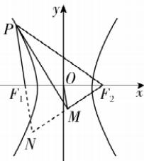

> [!faq]- 答案与解析
>
> > [!success]- **【答案】** A
>
> > [!note]- **【解析】**
> > 由 $\left|F_{1}F_{2}\right|=2c=6$ , 得 c=3
> >
> > 设 $PF_{1}$ 与 $F_{2}M$ 的延长线交于点 N，如图，由直线 PM 平分 $\angle F_{1}PF_{2}$ ，且 $F_{2}M \perp PM$ ，可得 $\triangle PF_{2}N$ 为
> >
> > 
> >
> > 等腰三角形, 则 M 为 $F_{2}N$ 的中点, 可得 $\left|F_{1}N\right|=2\left|OM\right|=2\sqrt{3}$ , 又因为 $\left|PF_{2}\right|=\left|PN\right|=\left|PF_{1}\right|+\left|F_{1}N\right|=\left|PF_{1}\right|+2\sqrt{3}$ , 可得 $\left|PF_{2}\right|-\left|PF_{1}\right|=2a=2\sqrt{3}$ , 即 $a=\sqrt{3}$ , 所以双曲线 E 的离心率为 $e=\frac{c}{a}=\sqrt{3}$ . 故选 A.
