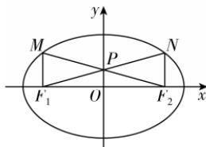

> [!faq]- 答案与解析
>
> > [!success]- **【答案】** B
>
> > [!note]- **【解析】**
> > 如图，由于 $MF_{1} / / NF_{2},MF_{2}$ 与 $NF_{1}$ 的交点在 $y$ 轴上，结合椭圆的对称性，
> >
> > 
> >
> > 可得 $MF_{1} \perp F_{1}F_{2}, NF_{2} \perp F_{1}F_{2}$ , 设 $M(-c, \text{点悟})$ ：假设 $MF_{1}, NF_{2}$ 均不与 $F_{1}F_{2}$ 垂直，设 $MF_{2}$ 交 $y$ 轴于点 $P$ , 连接 $F_{1}P$ 并延长交椭圆于点 $N$ , 此时 $MF_{1}$ 与 $NF_{2}$ 不平行, 故假设不成立 $y)(y > 0)$ , 代入 $E: \frac{x^{2}}{a^{2}} + \frac{y^{2}}{b^{2}} = 1 (a > b > 0)$ 中, 得 $\frac{c^{2}}{a^{2}} + \frac{y^{2}}{b^{2}} = 1$ ,
> >
> > 解得 $y = \frac{b^{2}}{a}$ , 故 $M\left(-c, \frac{b^{2}}{a}\right)$ .
> >
> > 设 $MF_{2}$ 与 $NF_{1}$ 的交点为 $P$ , 则 $P\left(0, \frac{b}{3}\right)$ .
> >
> > 显然 $\triangle MF_{1}F_{2} \sim \triangle POF_{2}$ , 则 $\frac{|OP|}{|MF_{1}|} = \frac{|OF_{2}|}{|F_{1}F_{2}|} = \frac{1}{2}$ , 将 $|MF_{1}| = \frac{b^{2}}{a}, |OP| = \frac{b}{3}$ 代入上式, 得 $\frac{\frac{b}{3}}{\frac{b^{2}}{a}} = \frac{1}{2}$ , 化简得 $\frac{b}{a} = \frac{2}{3}$ ,
> >
> > 即 $e = \frac{c}{a} = \sqrt{\frac{c^{2}}{a^{2}}} = \sqrt{\frac{a^{2} - b^{2}}{a^{2}}} = \sqrt{1 - \left(\frac{b}{a}\right)^{2}} = \sqrt{1 - \frac{4}{9}} = \frac{\sqrt{5}}{3}$ . 故选 B.
