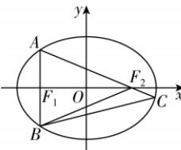

> [!faq]- 答案与解析
>
> > [!success]- **【答案】** D
>
> > [!note]- **【解析】**
> > 由 $S_{\triangle ABC} = 5S_{\triangle BCF_{2}}$ ，可得 $\frac{S_{\triangle ABC}}{S_{\triangle BCF_{2}}} = \frac{|AC|}{|CF_{2}|} = 5$ ，故 $\overrightarrow{AF_{2}} = 4\overrightarrow{F_{2}C}$ ，且 $F_{2}(c,0)$ .
> >
> > 不妨设点 A 在第二象限, 将 x = -c 代入椭圆方程得 $\frac{c^{2}}{a^{2}} +$
> >
> > 
> >
> > $\frac{y^{2}}{b^{2}}=1$ , 解得 $y=\pm\frac{b^{2}}{a}$ ，即点 $A\left(-c,\frac{b^{2}}{a}\right)$ .
> > 设点 $C(x_{0},y_{0})$ ，由 $\overrightarrow{AF_{2}}=4\overrightarrow{F_{2}C}$ 得 $\left(2c,-\frac{b^{2}}{a}\right)=4\left(x_{0}-c,y_{0}\right)$ ，即 $\left\{\begin{aligned}&4(x_{0}-c)=2c,\\ &4y_{0}=-\frac{b^{2}}{a},\end{aligned}\right.$ 解得 $\left\{\begin{aligned}&x_{0}=\frac{3c}{2},\\ &y_{0}=-\frac{b^{2}}{4a},\end{aligned}\right.$ 即点 $C\left(\frac{3c}{2},-\frac{b^{2}}{4a}\right)$ ，将点 C 的坐标代入椭圆方程得 $\frac{9c^{2}}{4a^{2}}+\frac{b^{2}}{16a^{2}}=1$ ，即 $\frac{9c^{2}}{4a^{2}}+\frac{a^{2}-c^{2}}{16a^{2}}=1$ ，故有 $\frac{9}{4}e^{2}+\frac{1}{16}(1-e^{2})=1$ ，解得 $e=\frac{\sqrt{21}}{7}$ . 故选 D.
> >
> > $$
> > \left[ \frac {2}{5}, \frac {7}{1 6} \right]
> > $$
