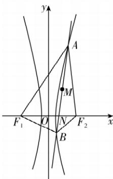

> [!faq]- 答案与解析
>
> > [!success]- **【答案】** $\left(\frac{3}{4}, 0\right)$
>
> > [!note]- **【解析】**
> > 根据离心率为 $\sqrt{17}$ ，可知 $\sqrt{17} = \frac{c}{a} \Rightarrow 1 + \frac{b^{2}}{a^{2}} = 17 \Rightarrow \frac{b^{2}}{a^{2}} = 16$ 。设 $A(x_{1}, y_{1}), B(x_{2}, y_{2}), x_{1} \neq x_{2}$ ，则 $\frac{x_{1}^{2}}{a^{2}} - \frac{y_{1}^{2}}{b^{2}} = 1, \frac{x_{2}^{2}}{a^{2}} - \frac{y_{2}^{2}}{b^{2}} = 1$ ，两式相减得 $\frac{x_{1}^{2}-x_{2}^{2}}{a^{2}} - \frac{y_{1}^{2}-y_{2}^{2}}{b^{2}} = 0$ ,
> >
> > 故 $\frac{b^{2}}{a^{2}} = \frac{y_{1}^{2}-y_{2}^{2}}{x_{1}^{2}-x_{2}^{2}} = \frac{y_{1}-y_{2}}{x_{1}-x_{2}} \cdot \frac{y_{1}+y_{2}}{x_{1}+x_{2}} \Rightarrow \frac{b^{2}}{a^{2}} = k_{AB} \cdot k_{OM}$ ，故 $16 = k_{AB} \cdot 2$ ，故 $k_{AB} = 8$ ，故直线 AB 的方程为 $y = 8(x - 1) + 2$ ，令 y = 0，则 $x = \frac{3}{4}$ ，故直线 AB 与 x 轴的交点为 $\left(\frac{3}{4}, 0\right)$ ，故 $|NA| + |NB| \geqslant |AB|$ ，当且仅当 A, N, B 三点共线时取等号， $|NF_{1}| + |NF_{2}| \geqslant |F_{1}F_{2}|$ ，当且仅当 $F_{1}, F_{2}, N$ 三点共线时取等号，故 $|NA| + |NB| + |NF_{1}| + |NF_{2}| \geqslant |F_{1}F_{2}| + |AB|, |F_{1}F_{2}|, |AB|$ 为定值，当且仅当 N 是 $F_{1}F_{2}$ 和 AB 的交点时取等号，故 $N\left(\frac{3}{4}, 0\right)$ .
> >
> > →点悟：由 A, N, B 三点共线， $F_{1}, F_{2}, N$ 三点共线可知 N 是 $F_{1}F_{2}$ 和 AB 的交点
> >
> > 
