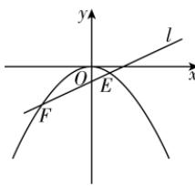

> [!faq]- 答案与解析
>
> > [!success]- **【答案】** 见解析
>
> > [!note]- **【解析】**
> > (1)由题意知,动点 M 到点 $(0,-4)$ 的距离比它到直线 y-6=0 的距离小 2,则动点 M 到
> >
> > 
> >
> > 点(0,-4)的距离与它到直线 y=4 的距离相等，则动点 M 的轨迹是以(0,-4)为焦点，y=4 为准线的抛物线，所以曲线 C 的方程为 $x^{2}=-16y$ .
> > (2) 易知直线 l 的斜率存在，设直线 l 的斜率为 $k, E(x_{1}, y_{1}), F(x_{2}, y_{2})$ ，则 $\left\{\begin{aligned}x_{1}^{2}&=-16y_{1},\\ x_{2}^{2}&=-16y_{2}\end{aligned}\right.$ 两式相减得 $x_{1}^{2}-x_{2}^{2}=-16\cdot(y_{1}-y_{2})$ ，整理得 $\frac{y_{1}-y_{2}}{x_{1}-x_{2}}=-\frac{x_{1}+x_{2}}{16}$ . 因为 EF 的中点为 $(-3,-2)$ ，所以 $x_{1}+x_{2}=-6, y_{1}+y_{2}=-4$ ，则 $k=\frac{y_{1}-y_{2}}{x_{1}-x_{2}}=-\frac{x_{1}+x_{2}}{16}=-\frac{-6}{16}=\frac{3}{8}$ ，所以直线 l 的方程为 $y+2=\frac{3}{8}(x+3)$ ，即 $3x-8y-7=0$ .
> > 又直线 $3x-8y-7=0$ 过点 $\left(0,-\frac{7}{8}\right)$ ，故直线 $3x-8y-7=0$ 与抛物线相交，满足条件.
> > 因此直线 l 的方程为 $3x-8y-7=0$ .
