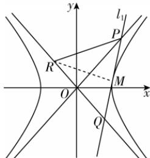

> [!faq]- 答案与解析
>
> > [!success]- **【答案】** -2
>
> > [!note]- **【解析】**
> > 因为 $M(x_{0}, y_{0})$ 为双曲线 $x^{2}-y^{2}=4$ 上的动点，所以 $x_{0}^{2}-y_{0}^{2}=4$ ，则 $y_{0}^{2}=x_{0}^{2}-4, x_{0}\geqslant2$ ，由题意得直线 $l_{1}: x_{0}x-y_{0}y=4$ 是双曲线 $x^{2}-y^{2}=4$ 的切线，切点为 $M(x_{0}, y_{0})$ ，而双曲线 $x^{2}-y^{2}=4$ 的渐近线方程为 $y=\pm x$ ，则 OP⊥OQ，联立 $\left\{\begin{aligned}x_{0}x-y_{0}y=4,\\ y=x,\end{aligned}\right.$ 解得 $x=y=\frac{4}{x_{0}-y_{0}}=\frac{x_{0}^{2}-y_{0}^{2}}{x_{0}-y_{0}}=x_{0}+y_{0}$ ，所以点 P 的坐标为 $(x_{0}+y_{0}, x_{0}+y_{0})$ ，联立 $\left\{\begin{aligned}x_{0}x-y_{0}y=4,\\ y=-x,\end{aligned}\right.$ 解得 $\left\{\begin{aligned}x=x_{0}-y_{0},\\ y=-x_{0}+y_{0},\end{aligned}\right.$ 所以点 Q 的坐标为 $(x_{0}-y_{0},-x_{0}+y_{0})$ ，所以线段 PQ 的中点为 $M(x_{0}, y_{0})$ ，如图，连接 RM，则 $\overrightarrow{RP}\cdot\overrightarrow{RQ}=(\overrightarrow{RM}+\overrightarrow{MP})\cdot(\overrightarrow{RM}+\overrightarrow{MQ})=\left(\overrightarrow{RM}-\frac{1}{2}\overrightarrow{PQ}\right)\cdot\left(\overrightarrow{RM}+\frac{1}{2}\overrightarrow{PQ}\right)=\overrightarrow{RM}^{2}-\frac{1}{4}\overrightarrow{PQ}^{2}\geqslant$ $\left(\frac{1}{2}\overrightarrow{OP}\right)^{2}-\frac{1}{4}\overrightarrow{PQ}^{2}=\frac{1}{4}\overrightarrow{OP}^{2}-\frac{1}{4}PQ^{2}=$ $-\frac{1}{4}\overrightarrow{OQ}^{2}$ (当且仅当 $MR \perp OQ$ 时取等号).
> >
> > 由题意可得直线 PQ 的斜率大于零或不存在, 故 $0<|\overrightarrow{OQ}| \leqslant 2\sqrt{2}$ , 当且仅当 M 为双曲线右顶点时取等号, 所以 $-\frac{1}{4}\overrightarrow{OQ}^{2} \geqslant -\frac{1}{4} \times 8 = -2$ , 所以 $\overrightarrow{RP} \cdot \overrightarrow{RQ}$ 的最小值为 -2.
> >
> > 
