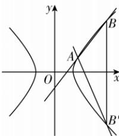

> [!faq]- 答案与解析
>
> > [!success]- **【答案】** 见解析
>
> > [!note]- **【解析】**
> > 设双曲线 E 的半焦距为 $c(c>0)$ . 由题意知 P 在双曲线 E 的右支上, $\left|PF_{1}\right| - \left|PF_{2}\right| = 2a = 6$ , $\therefore a = 3$ ,(1)【解】由题意知 $A(-1,0), B(1,0)$ ，因为曲线 $C$ 是以 $A, B$ 两点为顶点的双曲线，所以设双曲线 $C$ 的方程为 $x^{2} - \frac{y^{2}}{b^{2}} = 1 (b > 0)$ . 因为双曲线 $C$ 的离心率为 2，所以 $\frac{\sqrt{1 + b^2}}{1} = 2$ ，解得 $b = \sqrt{3}$ ，所以双曲线 $C$ 的方程为 $x^{2} - \frac{y^{2}}{3} = 1$ . (2)【证明】设点 $P(x_{1}, y_{1}), T(x_{2}, y_{2})$ ，由题意可知，直线 $AP$ 的斜率存在且不为 0，设直线 $AP$ 的方程为 $y = k(x + 1)$ ， $0 < k < \sqrt{3}$ ，联立 $\left\{ \begin{array}{l} y = k(x + 1), \\ x^{2} + \frac{y^{2}}{3} = 1, \end{array} \right.$ 消去 $y$ 得 $(3 + k^{2})x^{2} + 2k^{2}x + k^{2} - 3 = 0$ ，易知 $\Delta_{1} > 0$ ，则 $-1 \times x_{2} = \frac{k^{2} - 3}{3 + k^{2}}$ ，则 $x_{2} = \frac{3 - k^{2}}{3 + k^{2}}$ 。联立 $\left\{ \begin{array}{l} y = k(x + 1), \\ x^{2} - \frac{y^{2}}{3} = 1, \end{array} \right.$ 消去 $y$ 得 $(3 - k^{2})x^{2} - 2k^{2}x - k^{2} - 3 = 0$ ，易知 $\Delta_{2} > 0$ ，同理可得 $x_{1} = \frac{3 + k^{2}}{3 - k^{2}}$ ，所以 $x_{1} \cdot x_{2} = \frac{3 + k^{2}}{3 - k^{2}} \times \frac{3 - k^{2}}{3 + k^{2}} = 1$ . (3)【解】设点 $P(x_{1}, y_{1}), T(x_{2}, y_{2})$ ，则 $\overrightarrow{PA} = (-1 - x_{1}, -y_{1}), \overrightarrow{PB} = (1 - x_{1}, -y_{1})$ ，因为 $\overrightarrow{PA} \cdot \overrightarrow{PB} \leqslant 12$ ，所以 $(-1 - x_{1})(1 -$
> >
> > 专题8 圆锥曲线中的定点、定值问题 $\because e = \frac{c}{a} = \frac{\sqrt{21}}{3}, \therefore c = \sqrt{21}, \therefore b^2 = c^2 - a^2 = (\sqrt{21})^2 - 3^2 = 12, \therefore E$ 的方程为 $\frac{x^2}{9} - \frac{y^2}{12} = 1.$ (2)【证明】依题意知直线 $l$ 的倾斜角不为0，则设直线 $l$ 的方程为 $x = my + 2$ ， $A(x_1, y_1), B(x_2, y_2)$ . 联立 $\left\{ \begin{array}{l} x = my + 2, \\ 4x^2 - 3y^2 - 36 = 0, \end{array} \right.$ 消去 $x$ 并整理得 $(4m^2 - 3)y^2 + 16my - 20 = 0, \therefore 4m^2 - 3 \neq 0$ ，且 $\Delta = (16m)^2 - 4 \times (-20) \times (4m^2 - 3) > 0$ ，解得 $m^2 > \frac{5}{12}$ ，且 $m^2 \neq \frac{3}{4}$ . $\therefore y_1 + y_2 = -\frac{16m}{4m^2 - 3}, y_1y_2 = -\frac{20}{4m^2 - 3}$ . 由题意知， $B'(x_2, -y_2), \therefore$ 直线 $AB'$ 的方程为 $y - y_1 = \frac{y_1 + y_2}{x_1 - x_2}(x - x_1)$ . 令 $y = 0$ ，得 $x = \frac{y_1(x_2 - x_1)}{y_1 + y_2} + x_1$ $= \frac{y_1x_2 - y_1x_1 + y_1x_1 + y_2x_1}{y_1 + y_2} = \frac{y_1x_2 + y_2x_1}{y_1 + y_2}$ $= \frac{y_1(my_2 + 2) + y_2(my_1 + 2)}{y_1 + y_2}$
> >
> > $x_{1})+y_{1}^{2}\leqslant12$ ，即 $x_{1}^{2}+y_{1}^{2}\leqslant13$ .
> > 因为点 P 在双曲线 C 上，即 $x_{1}^{2}-\frac{y_{1}^{2}}{3}=1$ ，所以 $x_{1}^{2}+3x_{1}^{2}-3\leqslant13$ ，即 $x_{1}^{2}\leqslant4$ 。又点 P 是双曲线 C 在第一象限内的一点，所以 $1<x_{1}\leqslant2$ 。
> > 因为 $S_{1}=\frac{1}{2}|AB||y_{2}|=|y_{2}|,S_{2}=\frac{1}{2}|OB||y_{1}|=\frac{1}{2}|y_{1}|$ ，所以 $S_{1}^{2}\cdot S_{2}^{2}=y_{2}^{2}\cdot\frac{1}{4}y_{1}^{2}=\frac{9(1-x_{2}^{2})(x_{1}^{2}-1)}{4}.$ 由(2)知， $x_{2}=\frac{1}{x_{1}}$ ，设 $t=x_{1}^{2}$ ，则 $1<t\leqslant4$ ，
> > 则 $S_{1}^{2}\cdot S_{2}^{2}=\frac{9}{4}\left(t+\frac{1}{t}-2\right)$ ,
> > 令 $f(t)=t+\frac{1}{t}$ ，由对勾函数的单调性得 $f(t)=t+\frac{1}{t}$ 在区间(1,4]上单调递增，
> >
> > 避坑：不满足等号取到的条件，不要盲目使用基本不等式
> > 又 $f(1)=2,f(4)=\frac{17}{4}$ ，则 $2<f(t)\leqslant\frac{17}{4}$ ，
> > 则 $S_{1}^{2}\cdot S_{2}^{2}\in\left(0,\frac{81}{16}\right]$ ，所以 $S_{1}S_{2}\in\left(0,\frac{9}{4}\right]$ ，故 $S_{1}S_{2}$ 的取值范围为 $\left(0,\frac{9}{4}\right]$ .
> >
> > $= \frac{2my_{1}y_{2}}{y_{1} + y_{2}} + 2 = \frac{2m\times\left(-\frac{20}{4m^{2} - 3}\right)}{-\frac{16m}{4m^{2} - 3}} + 2$ $= \frac{9}{2},$ ∴直线 $AB^{\prime}$ 恒过点 $\left(\frac{9}{2},0\right)$
> >
> > 
> >
> > ## 规律方法 圆锥曲线中定点问题的两种解法
> >
> > 两种解法
> > (1) 引入参数法: 引入动点的坐标或动线中系数为参数表示变化量, 再研究变化的量与参数何时没有关系, 找到定点.
> > (2) 特殊到一般法: 根据动点或动线的特殊情况探索出定点, 再证明该定点与变量无关.
