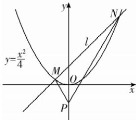

> [!faq]- 答案与解析
>
> > [!success]- **【答案】** 证明见解析
>
> > [!note]- **【解析】**
> > (1)由题意可知 $M(-2,1)$ , $N(4,4)$ ，则直线 MN 的斜率 $k_{MN}=\frac{4-1}{4-(-2)}=\frac{1}{2}$ ，线段 MN 的中点坐标为 $\left(1,\frac{5}{2}\right)$ ，所以直线 l 的方程为 $y-4=\frac{1}{2}(x-4)$ ，即 $x-2y+4=0$ ，线段 MN 的垂直平分线的斜率为 -2，所以线段 MN 的垂直平分线的方程为 $y-\frac{5}{2}=-2(x-1)$ ，即 $4x+2y-9=0$ 。
> > (2) 存在符合题意的点 $P(0,-a)$ ，理由如下：
> > 设点 $P(0,b)$ 为符合题意的点， $M(x_{1},y_{1}), N(x_{2},y_{2})$ ，直线 PM, PN 的斜率分别为 $k_{1}, k_{2}$ .
> > 联立 $\left\{\begin{aligned}y=kx+a,\\ y=\frac{x^{2}}{4},\end{aligned}\right.$ 得 $x^{2}-4kx-4a=0$ 因为 a>0，所以 $\Delta=16k^{2}+16a>0$ ，可得 [192]
> >
> > $-\frac{1}{k}\left(x-\frac{1}{2}\right)$ ，即 $y=-\frac{1}{k}\left(x-\frac{3}{8}\right)$ .
> > 故线段 MN 的垂直平分线恒过定点 $S\left(\frac{3}{8},0\right)$ ②【证明】由弦长公式得 $|MN|=\sqrt{1+k^{2}}\cdot$ $\left|x_{1}-x_{2}\right|=\frac{\sqrt{1+k^{2}}}{1+4k^{2}}\sqrt{16(1+4k^{2}-m^{2})}=$ $\frac{4\sqrt{1+k^{2}}}{1+4k^{2}}\sqrt{1+4k^{2}-m^{2}}$ 坐标原点到直线 MN 的距离 d= $\frac{|m|}{\sqrt{1+k^{2}}}$ , 且 $m\neq0$ ,
> > 所以 $\triangle OMN$ 的面积 $S_{\triangle OMN}=\frac{1}{2}\times$ $|MN|\times d=\frac{1}{2}\times\frac{4\sqrt{1+k^{2}}}{1+4k^{2}}\sqrt{1+4k^{2}-m^{2}}\times$ $\frac{|m|}{\sqrt{1+k^{2}}} = 2 \times \frac{|m| \sqrt{1+4k^{2}-m^{2}}}{1+4k^{2}} \leqslant 2 \times$ $\frac{\frac{m^{2}+1+4k^{2}-m^{2}}{2}}{1+4k^{2}}=1$ ，当且仅当 $m^{2}=1+4k^{2}-m^{2}$ ，即 $2m^{2}=1+4k^{2}$ 时等号成立，
> > 此时满足 $\Delta>0$ .
> > 所以当 $S_{\triangle OMN}$ 取最大值时，
> >
> > 专题9 圆锥曲线中的存在、探索性问题 $x_{1}+x_{2}=4k,x_{1}x_{2}=-4a,$ 从而 $k_{1}+k_{2}=\frac{y_{1}-b}{x_{1}}+\frac{y_{2}-b}{x_{2}}=\frac{kx_{1}+a-b}{x_{1}}+$ $\frac{kx_{2}+a-b}{x_{2}}=\frac{2kx_{1}x_{2}+(a-b)(x_{1}+x_{2})}{x_{1}x_{2}}=$ $\frac{-8ka+4k(a-b)}{-4a}=\frac{k(a+b)}{a},$ 因为 k 不恒为 0，所以当且仅当 b=-a 时，恒有 $k_{1}+k_{2}=0$ ，
> > 此时直线 PM 与直线 PN 的倾斜角互补，即 $\angle OPM = \angle OPN$ ，
> > 所以存在点 $P(0,-a)$ 符合题意.
> >
> > 
