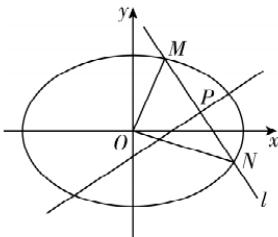
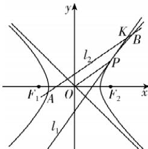

> [!faq]- 答案与解析
>
> > [!success]- **【答案】** 见解析
>
> > [!note]- **【解析】**
> > (1)依题意得 $\left\{\begin{aligned}&2c=2\sqrt{2},\\ &\frac{b}{a}=1,\\ &c^{2}=a^{2}+b^{2},\end{aligned}\right.$ 解得$k_{OM}k_{ON}=\frac{y_{1}y_{2}}{x_{1}x_{2}}$ $=\frac{(kx_{1}+m)(kx_{2}+m)}{x_{1}x_{2}}$ $=\frac{k^{2}x_{1}x_{2}+km(x_{1}+x_{2})+m^{2}}{x_{1}x_{2}}$ $=\frac{k^{2}(4m^{2}-4)-8k^{2}m^{2}+m^{2}(1+4k^{2})}{4m^{2}-4}$ $=\frac{m^{2}-4k^{2}}{4m^{2}-4}=\frac{1-m^{2}}{4m^{2}-4}=-\frac{1}{4}.$ 所以直线 OM 与 ON 的斜率之积为定值 $-\frac{1}{4}.$
> >
> > 
> >
> > 规律方法 解决圆锥曲线中的定值问题的基本思想是函数思想,可以用变量表示问题中的直线方程、数量积、比例关系等,这些直线方程、数量积、比例关系中不受变量影响的某个值,就是要求的定值.具体地说,就是将要证明或要求解的量表示为关于某个合适变量的函数,化简消去变量即得定值.
> >
> > $a = b = 1, c = \sqrt{2}$ , 所以 $\Gamma$ 的方程为 $x^{2} - y^{2} = 1$ .
> >
> > (2) 由 (1) 知 $F_{1}(-\sqrt{2}, 0)$ , 双曲线 $\Gamma$ 的方程为 $x^{2} - y^{2} = 1$ , 联立 $\left\{ \begin{array}{l} y = \sqrt{2} x + t, \\ x^{2} - y^{2} = 1, \end{array} \right.$ 消去 $y$ 并化简得 $x^{2} + 2\sqrt{2} tx + t^{2} + 1 = 0$ , 由题意可得 $\Delta = 8t^{2} - 4(t^{2} + 1) = 0$ , 解得 $t = \pm 1$ , 因为 $t < 0$ , 所以 $t = -1$ , 代入上式, 解得 $x = \sqrt{2}, y = 1$ , 所以 $P(\sqrt{2}, 1)$ .
> >
> > 设 $Q(0, q)$ , 因为 $\angle F_{1}QP$ 为直角, 所以 $\overrightarrow{QF_{1}} \cdot \overrightarrow{QP} = (-\sqrt{2}, -q) \cdot (\sqrt{2}, 1 - q) = -\sqrt{2} \times \sqrt{2} - q(1 - q) = 0$ , 解得 $q = 2$ 或 $-1$ , 所以 $Q(0, 2)$ 或 $(0, -1)$ .
> >
> > (3) 易知 $k_{OP} = \frac{\sqrt{2}}{2}$ , 设 $A(x_{1}, y_{1}), B(x_{2}, y_{2})$ , $l_{2}: y = \frac{\sqrt{2}}{2} x + m$ , 联立 $\left\{ \begin{array}{l} y = \frac{\sqrt{2}}{2} x + m, \\ x^{2} - y^{2} = 1, \end{array} \right.$ 消去 $y$ 并化简得 $x^{2} - 2\sqrt{2} mx - 2m^{2} - 2 = 0$ , 则 $\Delta = 8m^{2} -$
> >
> > <!-- MinerU Part 3 Pages 101-119 -->
> >
> > $4(-2m^{2}-2)=16m^{2}+8>0,x_{1}+x_{2}=2\sqrt{2}m,x_{1}x_{2}=-2(m^{2}+1)$ ，联立 $\left\{\begin{aligned}&y=\frac{\sqrt{2}}{2}x+m,\\&y=\sqrt{2}x-1,\end{aligned}\right.$ 解得 $\left\{\begin{aligned}&x=\sqrt{2}m+\sqrt{2},\\&y=2m+1,\end{aligned}\right.$ 所以 $K(\sqrt{2}m+\sqrt{2},2m+1)$ .
> > 假设存在 $\lambda$ 满足题意，则 $\sqrt{1+\left(\frac{\sqrt{2}}{2}\right)^{2}}\cdot|x_{1}-x_{K}|\cdot\sqrt{1+\left(\frac{\sqrt{2}}{2}\right)^{2}}\cdot|x_{2}-x_{K}|=$ 巧思：也可利用两点间距离公式求解 $\lambda\left[\left(\sqrt{2}m+\sqrt{2}-\sqrt{2}\right)^{2}+\left(2m+1-1\right)^{2}\right]$ ，即 $\frac{3}{2}|x_{1}x_{2}-x_{K}(x_{1}+x_{2})+x_{K}^{2}|=6m^{2}\lambda$ ，代入点 K 坐标及根与系数的关系化简得 $6m^{2}=6m^{2}\lambda$ ，解得 $\lambda=1$ 。故存在 $\lambda=1$ ，使得 $|KA|\cdot|KB|=\lambda|KP|^{2}$
> >
> > 
