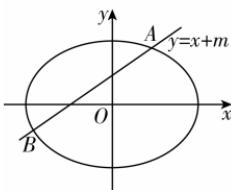

> [!faq]- 答案与解析
>
> > [!success]- **【答案】** 见解析
>
> > [!note]- **【解析】**
> > (1)因为椭圆 $C:\frac{x^{2}}{a^{2}}+\frac{y^{2}}{b^{2}}=1(a>b>0)$ 的长轴长为 6，所以 $2a=6\Rightarrow a=3$ 。又因为椭圆的离心率 $e=\frac{2}{3}$ ，所以 $e=\frac{2}{3}=\frac{c}{a}\Rightarrow\frac{2}{3}=\frac{c}{3}\Rightarrow c=2$ ，所以 $b^{2}=a^{2}-c^{2}=9-4=5$ ，故椭圆 C 的标准方程为 $\frac{x^{2}}{9}+\frac{y^{2}}{5}=1$ 。
> >
> > (2) ① 如图所示，联立 $\left\{\begin{aligned}\frac{x^{2}}{9}+\frac{y^{2}}{5}&=1,\\ y=x+m,\end{aligned}\right.$ 去 y 整理得
> >
> > 
> >
> > $14x^{2}+18mx+9m^{2}-45=0$ ,
> > 因为直线 y=x+m 与椭圆 C 相交于 A, B 两点，所以 $\Delta=(18m)^{2}-4\times14\cdot(9m^{2}-45)>0\Rightarrow-\sqrt{14}<m<\sqrt{14}$ ，设 $A(x_{1},y_{1}), B(x_{2},y_{2})$ ，则 $x_{1}+x_{2}=-\frac{18m}{14}=-\frac{9m}{7}$ ， $x_{1}x_{2}=\frac{9m^{2}-45}{14}$ ，则 $\left|AB\right|=\sqrt{1+1}\cdot\left|x_{1}-x_{2}\right|=\sqrt{2}\times\sqrt{\left(x_{1}-x_{2}\right)^{2}}=\sqrt{2}\times$
> >
> > ## 刷速度
