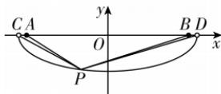

> [!faq]- 答案与解析
>
> > [!success]- **【答案】** AC
>
> > [!note]- **【解析】**
> > 由 $y = -\sqrt{1 - \frac{x^{2}}{6}}$ ( $y \neq 0$ ), 得 $\frac{x^{2}}{6} + y^{2} = 1$ (y < 0), 则曲线 M 是椭圆 $\frac{x^{2}}{6} + y^{2} = 1$ 的下半部分（不包含左、右顶点），
> >
> > 避坑：对曲线方程进行化简时要注意变量的取值范围
> >
> > 
> >
> > 则 A, B 分别是椭圆 $\frac{x^{2}}{6} + y^{2} = 1$ 的左、右焦点，C, D 分别是椭圆 $\frac{x^{2}}{6} + y^{2} = 1$ 的左、右顶点，根据椭圆的定义可知 $|PA| + |PB| = 2a = 2\sqrt{6}$ ，A 正确。
> > 当 P 为椭圆 $\frac{x^{2}}{6} + y^{2} = 1$ 的下顶点时， $\triangle PCD$ 的面积取得最大值，为 $\frac{1}{2} \times 1 \times 2\sqrt{6} = \sqrt{6}$ ，B 错误.
> > 设 $P(x, y)$ ，则直线 PC 与 PD 的斜率之积为 $\frac{y^{2}}{x^{2}-6}=\frac{1-\frac{x^{2}}{6}}{x^{2}-6}=-\frac{1}{6}$ ，C 正确.
> > 由 $PA \perp PB, |PB| > |PA|$ ，得 $|PA|^{2} + |PB|^{2} = |AB|^{2}$ ，则 $(2\sqrt{6}-|PB|)^{2} + |PB|^{2} = (2\sqrt{5})^{2}$ ，且 $|PB| > 2\sqrt{6} - |PB|$ ，解得 $|PB| = \sqrt{6} + 2$ ，则 $|PA| = \sqrt{6}-2$ ，则 $\tan\angle PAB=\frac{|PB|}{|PA|}=\frac{\sqrt{6}+2}{\sqrt{6}-2}=5+2\sqrt{6}$ ，D 错误. 故选 AC.
