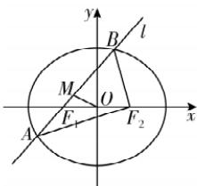

> [!faq]- 答案与解析
>
> > [!success]- **【答案】** ACD
>
> > [!note]- **【解析】**
> > 对于 A, 根据椭圆的定义计算易判断; 对于 B, 由直线 l 与椭圆方程联立, 写出根与系数的关系, 利用弦长公式计算 $\left|AB\right|$ , 结合函数的单调性即可判断; 对于 C, 利用点差法易判断; 对于 D, 通过计算推得 $x_{1}^{2} + y_{1}^{2} = 5c^{2}$ , 结合 $\frac{x_{1}^{2}}{a^{2}} + \frac{y_{1}^{2}}{b^{2}} = 1$ , 消元求得 $x_{1}^{2} = \frac{a^{2}(5c^{2} - b^{2})}{c^{2}}$ , 根据椭圆上点的横坐标的范围可得 $0 \leqslant \frac{a^{2}(5c^{2} - b^{2})}{c^{2}} \leqslant a^{2}$ , 求解即得结果.
> > 【解析】对于 A, 由直线 l 的方程可知直线 l 过椭圆 C 的左焦点 $F_{1}$ ，因为点 A, B 是椭圆上的两点，所以 $\left|AF_{1}\right| + \left|AF_{2}\right| = \left|BF_{1}\right| + \left|BF_{2}\right| = 2a$ ，而 $\triangle ABF_{2}$ 的周长为 $\left|AB\right| + \left|AF_{2}\right| + \left|BF_{2}\right| = \left|AF_{1}\right| + \left|BF_{1}\right| + \left|AF_{2}\right| + \left|BF_{2}\right| = 4a$ ，故 A 正确；
> >
> > 
> >
> > 对于 B, 因为 $e = \frac{c}{a} = \frac{1}{2}$ ，所以 a = 2c, $b = \sqrt{3}c$ ，由 $\left\{\begin{aligned}\frac{x^{2}}{4c^{2}} + \frac{y^{2}}{3c^{2}} &= 1, \\ y = kx + kc,\end{aligned}\right.$ 消去 y，整理得 $(4k^{2} + 3)x^{2} + 8k^{2}cx + 4k^{2}c^{2} - 12c^{2} = 0$ ，因为直线 l 恒过点 $F_{1}(-c,0)$ ，所以 $\Delta > 0$ ，设 $A(x_{1},y_{1}), B(x_{2},y_{2})$ ，则
> >
> > 点悟：直线恒过椭圆内的点，所以直线和椭圆一定有两个交点，联立后的方程一定有两个不同的实数根 $\left\{\begin{aligned}x_{1}+x_{2}&=-\frac{8k^{2}c}{4k^{2}+3},\\ x_{1}\cdot x_{2}&=\frac{4k^{2}c^{2}-12c^{2}}{4k^{2}+3},\end{aligned}\right.$ 则 $|AB| = \sqrt{1+k^{2}}\cdot \sqrt{\left(-\frac{8k^{2}c}{4k^{2}+3}\right)^{2}-4\times\frac{4k^{2}c^{2}-12c^{2}}{4k^{2}+3}} = \frac{12c(1+k^{2})}{4k^{2}+3}$ ，设 $1+k^{2}=t$ ，则 $t \geqslant 1$ ，且 $k^{2}=t-1$ ，于是 $|AB|=\frac{12ct}{4t-1}=\frac{12c}{4-\frac{1}{t}}$ ，因为 $t \geqslant 1$ ，所以 $4>4-\frac{1}{t} \geqslant 3$ ，则有 $3c<|AB| \leqslant 4c$ ，故 B 错误；
> >
> > 对于 C，因为 $A(x_{1},y_{1}), B(x_{2},y_{2})$ ，所以 $M\left(\frac{x_{1}+x_{2}}{2},\frac{y_{1}+y_{2}}{2}\right)$ ，所以 $k_{OM} = \frac{y_{1}+y_{2}}{x_{1}+x_{2}}, k = \frac{y_{1}-y_{2}}{x_{1}-x_{2}}$ ，所以 $k_{OM} \cdot k = \frac{y_{1}^{2}-y_{2}^{2}}{x_{1}^{2}-x_{2}^{2}}$ ，又 $\left\{\begin{aligned}\frac{x_{1}^{2}}{a^{2}}+\frac{y_{1}^{2}}{b^{2}}=1,\\ \frac{x_{2}^{2}}{a^{2}}+\frac{y_{2}^{2}}{b^{2}}=1,\end{aligned}\right.$ 两式相减，可得 $\frac{x_{1}^{2}-x_{2}^{2}}{a^{2}}+\frac{y_{1}^{2}-y_{2}^{2}}{b^{2}}=0$ ，整理得 $\frac{y_{1}^{2}-y_{2}^{2}}{x_{1}^{2}-x_{2}^{2}}=-\frac{b^{2}}{a^{2}}$ ，故有 $k_{OM} \cdot k=-\frac{b^{2}}{a^{2}}$ ，故 C 正确；
> >
> > 对于 D，依题意， $\overrightarrow{AF_{1}}=(-c-x_{1},-y_{1}),\overrightarrow{AF_{2}}=(c-x_{1},-y_{1})$ ，则 $\overrightarrow{AF_{1}}\cdot\overrightarrow{AF_{2}}=x_{1}^{2}-c^{2}+y_{1}^{2}=4c^{2}$ ，则 $x_{1}^{2}+y_{1}^{2}=5c^{2}(*)$ ，由 $\frac{x_{1}^{2}}{a^{2}}+\frac{y_{1}^{2}}{b^{2}}=1$ 可得 $y_{1}^{2}=b^{2}\left(1-\frac{x_{1}^{2}}{a^{2}}\right)$ ，代入（\*），可得 $x_{1}^{2}+b^{2}\left(1-\frac{x_{1}^{2}}{a^{2}}\right)=5c^{2}$ ，解得 $x_{1}^{2}=a^{2}(5c^{2}-b^{2})/c^{2}$ ，因为 $-a\leqslant x_{1}\leqslant a$ ，所以 $0\leqslant\frac{a^{2}(5c^{2}-b^{2})}{c^{2}}\leqslant a^{2}$ ，化简得 $0\leqslant5c^{2}-b^{2}\leqslant$ $c^{2}$ ，因为 $b^{2}=a^{2}-c^{2}$ ，所以 $5c^{2}\leqslant a^{2}\leqslant6c^{2}$ ，则 $5e^{2}\leqslant1\leqslant6e^{2}$ ，解得 $\frac{\sqrt{6}}{6}\leqslant e\leqslant\frac{\sqrt{5}}{5}$ ，故 D 正确。故选 ACD.
