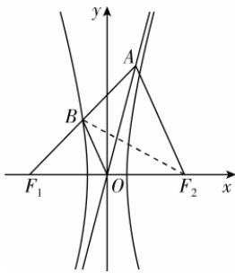

> [!faq]- 答案与解析
>
> > [!success]- **【答案】** 4
>
> > [!note]- **【解析】**
> > 如图, 连接 $BF_{2}$ , 因为 O 为线段 $F_{1}F_{2}$ 的中点, 且 $BO \parallel AF_{2}$ ,
> >
> > 
> >
> > 所以 B 是线段 $AF_{1}$ 的中点.
> > 又 $\left|AF_{1}\right|=\left|F_{1}F_{2}\right|$ ，所以 $\left|AB\right|=\left|BF_{1}\right|=\left|OF_{1}\right|=c,\left|BF_{2}\right|=\left|BF_{1}\right|+2a=2a+c.$ 因为 $\left|AF_{1}\right|=\left|F_{1}F_{2}\right|,\left|F_{1}O\right|=\left|F_{1}B\right|=c,\angle AF_{1}O=\angle F_{2}F_{1}B,$ 所以 $\triangle AF_{1}O \cong \triangle F_{2}F_{1}B$ ，因此 $\left|AO\right|=\left|F_{2}B\right|=2a+c.$
> >
> > ## 3.3.1 抛物线及其标准方程
