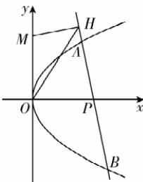

> [!faq]- 答案与解析
>
> > [!success]- **【答案】** B
>
> > [!note]- **【解析】**
> > 设 $A\left(\frac{y_{1}^{2}}{4}, y_{1}\right)$ , $B\left(\frac{y_{2}^{2}}{4}, y_{2}\right)$ ,
> > 其中 $y_{1} \neq 0, y_{2} \neq 0$ ,
> > ∵ 以|AB|为直径的圆过原点，∴ $\overrightarrow{OA} \cdot \overrightarrow{OB} = \frac{y_{1}^{2} y_{2}^{2}}{16} + y_{1} y_{2} = 0$ ，解得 $y_{1}y_{2} = -16$ .
> > 易知直线 AB 的斜率不为 0，不妨设直线 AB 的方程为 x = ty + m，
> > 由 $\left\{\begin{aligned}y^{2}&=4x,\\ x&=ty+m,\end{aligned}\right.$ 化简整理得 $y^{2}-4ty-4m=0,\therefore y_{1}y_{2}=-4m=-16$ ，解得 m=4，
> > ∴ 直线 AB 恒过定点 $P(4,0)$ ，∵ MH ⊥ AB，∠MOP = 90°，∴ O, P, H, M 四点共圆，
> > 即点 H 在以 |PM| 为直径的圆（除原点外）上运动，此时该圆直径为 |PM| = $\sqrt{4^{2}+4^{2}} = 4\sqrt{2}$ ∴ |OH| 的最大值为该圆的直径，即 $4\sqrt{2}$ . 故选 B.
> >
> > 
