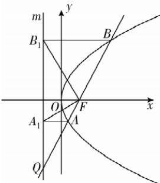

> [!faq]- 答案与解析
>
> > [!success]- **【答案】** ABD
>
> > [!note]- **【解析】**
> > 记 $BA$ 与准线 $m$ 交于点 $Q$ .
> >
> > 
> >
> > 对于 A, 设 $\left|FA\right| = \left|AA_{1}\right| = t, \left|FB\right| = \left|BB_{1}\right| = 3t, \left|AQ\right| = x,$ 由题意得 $\triangle QAA_{1} \sim \triangle QBB_{1}$ ，则 $\frac{|QA|}{|QB|} = \frac{|AA_{1}|}{|BB_{1}|}$ ，即 $\frac{x}{x+4t} = \frac{t}{3t} \Rightarrow x = 2t,$ 故 $\angle A_{1}AQ=60^{\circ}$ ，故 $k=\sqrt{3}$ ，故 A 正确.
> > 对于 B, 设 $A(x_{1}, y_{1})$ , $B(x_{2}, y_{2})$ ，联立直线 $l:y = k(x - 1)$ 与抛物线方程得 $\left\{ \begin{array}{l}y = k(x - 1),\\ y^2 = 4x, \end{array} \right.$ 得 $k^{2}x^{2} - (2k^{2} + 4)x + k^{2} =$ $0,\Delta >0,\therefore x_{1} + x_{2} = \frac{2k^{2} + 4}{k^{2}},x_{1}x_{2} = 1,$ $\therefore \frac{1}{|FA|} +\frac{1}{|FB|} = \frac{1}{x_1 + 1} +\frac{1}{x_2 + 1} =$ $\frac{x_1 + x_2 + 2}{x_1x_2 + (x_1 + x_2) + 1} = 1$ ，故B正确.巧思： $\frac{1}{|FA|} +\frac{1}{|FB|} = \frac{2}{p} = \frac{2}{2} = 1$ 对于C，若 $k = 1$ ，则 $x_{1} + x_{2} = 6,|AB| =$ $x_{1} + x_{2} + 2 = 8$ ，故C错误.对于D， $\because \angle BB_1F = \angle B_1FB,\angle AA_1F =$ $\angle A_{1}FA,$ $\therefore \angle B_1FB + \angle A_1FA = \frac{180^\circ - \angle B_1BF}{2}+$ $\frac{180^\circ - \angle A_1AF}{2} = 90^\circ$ ，故D正确.故选ABD.
