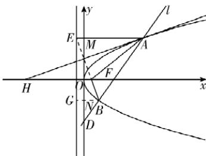

> [!faq]- 答案与解析
>
> > [!success]- **【答案】** BCD
>
> > [!note]- **【解析】**
> > 如图，设 AE 与 y 轴的交点为 M，过点 B 作 C 的准线的垂线 BG，垂足为 G，BG 与 y 轴的交点为 N，因为 $\left|AD\right|=4\left|BD\right|$ ，所以 $\frac{\left|BD\right|}{\left|AD\right|}=\frac{\left|BN\right|}{\left|AM\right|}=\frac{1}{4}$ ，因为 $\left|AF\right|=\left|AE\right|=\frac{9}{2}$ ， $\left|BF\right|=\left|BG\right|=\frac{3}{2}$ ，所以 $\frac{\left|BN\right|}{\left|AM\right|}=\frac{\frac{3}{2}-\frac{p}{2}}{\frac{9}{2}-\frac{p}{2}}=\frac{1}{4}$ ，解得 p=1，所以 $y^{2}=2x$ ，A 错误。 $\left|AE\right|-\left|BF\right|=\left|AF\right|-\left|BF\right|=\frac{9}{2}-\frac{3}{2}=3$ ，B 正确。
> >
> > 若 A 在第一象限，由 $x_{A}+\frac{p}{2}=\frac{9}{2}$ ，得 $x_{A}=4$ ，所以 $A(4,2\sqrt{2})$ ，同理可得 $B(1,-\sqrt{2})$ ， $k_{AB}=\frac{2\sqrt{2}-(-\sqrt{2})}{4-1}=\sqrt{2}$ ，所以直线 l 的方程为 $y+\sqrt{2}=\sqrt{2}(x-1)$ ；同理若 A 在第四象限，则直线 l 的方程为 $y-\sqrt{2}=-\sqrt{2}(x-1)$ ，所以直线 l 的方程为 $\sqrt{2}x\pm y-2\sqrt{2}=0$ ，C 正确。
> >
> > 如图，连接 EF，已知 $H(-4,0)$ ，由对称性不妨令 A 在第一象限，则由以上分析可知 $A(4,2\sqrt{2})$ ， $E\left(-\frac{1}{2},2\sqrt{2}\right)$ ， $F\left(\frac{1}{2},0\right)$ ，所以 $k_{AH}=\frac{2\sqrt{2}-0}{4-(-4)}=\frac{\sqrt{2}}{4}$ ， $k_{EF}=\frac{2\sqrt{2}-0}{-\frac{1}{2}-\frac{1}{2}}=-2\sqrt{2}$ ， $k_{AH}\cdot k_{EF}=-1$ ，
> > 所以直线 AH 与 EF 垂直。又因为 $\left|AF\right|=\left|AE\right|$ ，所以 AH 垂直平分线段 EF，所以直线 AE 与直线 AF 关于直线
> >
> > AH 对称, D 正确. 故选 BCD.
> >
> > 
