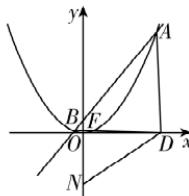

> [!faq]- 答案与解析
>
> > [!success]- **【答案】** $\pm\frac{\sqrt{11}}{2}$
>
> > [!note]- **【解析】**
> > 如图,作出符合题意
> >
> > 的图形. 因为抛物线 C 的方程为 $y = \frac{1}{4}x^{2}$ ，即 $x^{2} = 4y$ ，则焦点 F 的坐标为 $(0,1)$ ，所以可设直
> >
> > 
> >
> > 线 AB 的方程为 $y=kx+1$ ，与抛物线 C 的方程 $x^{2}=4y$ 联立，消去 y 得 $x^{2}-4kx-4=0$ ，设点 $A(x_{1},y_{1}), B(x_{2},y_{2}), D(a,0)$ ，则 $\Delta_{1}>0, x_{1}x_{2}=-4$ 。由 $|DA|=|DB|=|DN|=\sqrt{a^{2}+16}$ ，得 $\sqrt{(x_{1}-a)^{2}+y_{1}^{2}}=\sqrt{(x_{2}-a)^{2}+y_{2}^{2}}=\sqrt{a^{2}+16}$ ，即 $(x_{1}-a)^{2}+\frac{\text{点悟}}{\text{点悟}}$ ：两点间距离公式的应用 $y_{1}^{2}=a^{2}+16, (x_{2}-a)^{2}+y_{2}^{2}=a^{2}+16$ ，所以 $A(x_{1},y_{1}), B(x_{2},y_{2})$ 是方程 $(x-a)^{2}+y^{2}=a^{2}+16$ 的两个实数解，将 $y=kx+1$ 代入方程 $(x-a)^{2}+y^{2}=a^{2}+16$ ，整理得 $(x-a)^{2}+(kx+1)^{2}=a^{2}+16\Rightarrow(1+k^{2})x^{2}+(2k-2a)x-15=0$ ，此时 $\Delta_{2}>0, x_{1}x_{2}=\frac{-15}{1+k^{2}}$ ，因此 $\frac{-15}{1+k^{2}}=-4\Rightarrow k^{2}=\frac{11}{4}\Rightarrow k=\pm\frac{\sqrt{11}}{2}$ .
