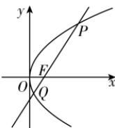

> [!faq]- 答案与解析
>
> > [!success]- **【答案】** 见解析
>
> > [!note]- **【解析】**
> > (1)∵ $A(6,m+2)$ , $B(24,m+8)$ 是抛物线 $C:y^{2}=2px(p>1)$ 上的两点，
> > ∴ $\left\{\begin{aligned}(m+2)^{2}&=12p,\\ (m+8)^{2}&=48p,\end{aligned}\right.$ 则 $\frac{(m+8)^{2}}{(m+2)^{2}}=4$ ，整理得 $m^{2}=16$ ，解得 $m=\pm4$ ，
> > 当 m=-4 时， $12p=(m+2)^{2}=4$ ，解得 $p=\frac{1}{3}<1$ ，不合题意；
> > 当 m=4 时， $12p=(m+2)^{2}=36$ ，解得 p=3>1，故抛物线 C 的方程为 $y^{2}=6x$ .
> >
> > (2)由(1)知 C 的焦点为 $F\left(\frac{3}{2},0\right)$ ，故直线 l 的方程为 $y=k\left(x-\frac{3}{2}\right)$ .
> >
> > 
> >
> > 联立 $\left\{\begin{aligned}y^{2}&=6x,\\ y=k\left(x-\frac{3}{2}\right),\end{aligned}\right.$ 得 $k^{2}x^{2}-(3k^{2}+6)x+\frac{9}{4}k^{2}=0$ ，必有 $\Delta>0$ ，
> >
> > 设 $P(x_{1},y_{1}),Q(x_{2},y_{2})$ ，则 $x_{1} + x_{2} =$ $\frac{3k^2 + 6}{k^2}$ $\therefore |PQ| = x_1 + x_2 + p = \frac{3k^2 + 6}{k^2} +3 = 6 + \frac{6}{k^2},$ $\therefore |PQ| + k^2 = 6 + \frac{6}{k^2} +k^2\geqslant 6 + 2\sqrt{6},$ 当且仅当 $\frac{6}{k^2} = k^2$ ，即 $k^2 = \sqrt{6}$ 时，等号成立， $\therefore |PQ| + k^2$ 的最小值为 $6 + 2\sqrt{6}$
