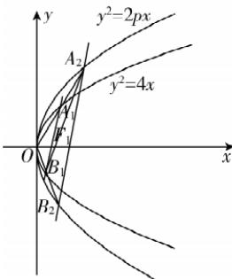

> [!faq]- 答案与解析
>
> > [!success]- **【答案】** 见解析
>
> > [!note]- **【解析】**
> > 设直线 $OA_{1}$ 的方程为 $y = k_{1}x$ ，则由 $\left\{\begin{aligned}y^{2} &= 4x, \\ y &= k_{1}x\end{aligned}\right.$ 得 $A_{1}\left(\frac{4}{k_{1}^{2}}, \frac{4}{k_{1}}\right)$ ，所以 $|OA_{1}| = \left|\frac{4}{k_{1}}\right| \sqrt{\frac{1}{k_{1}^{2}} + 1}$ 。由 $\left\{\begin{aligned}y^{2} &= 2px, \\ y &= k_{1}x\end{aligned}\right.$ 得 $A_{2}\left(\frac{2p}{k_{1}^{2}}, \frac{2p}{k_{1}}\right)$ ，所以 $|OA_{2}| = \left|\frac{2p}{k_{1}}\right| \sqrt{\frac{1}{k_{1}^{2}} + 1}$ 。因为 $|OA_{2}| = 2|OA_{1}|$ ，所以 $\left|\frac{2p}{k_{1}}\right| \sqrt{\frac{1}{k_{1}^{2}} + 1} = 2 \times \left|\frac{4}{k_{1}}\right| \sqrt{\frac{1}{k_{1}^{2}} + 1}$ ，又因为 p > 0，所以 p = 4。
> >
> > 多种解法 设 $A_{1}(x_{1}, y_{1})$ ， $A_{2}(x_{3}, y_{3})$ ，由 $|OA_{2}| = 2|OA_{1}|$ 可得 $\left\{\begin{aligned}x_{3} &= 2x_{1}, \\ y_{3} &= 2y_{1}\end{aligned}\right.$ 因为 $y_{1}^{2} = 4x_{1}$ ，所以 $\left(\frac{y_{3}}{2}\right)^{2} = 4 \times \frac{x_{3}}{2}$ ，所以 $y_{3}^{2} = 8x_{3}$ 。又 $y_{3}^{2} = 2px_{3}$ ，所以 2p = 8，p = 4。
> >
> > (2)【解】设直线 l 的方程为 x = my + 1, $A_{1}(x_{1}, y_{1})$ , $B_{1}(x_{2}, y_{2})$ , $A_{2}(x_{3}, y_{3})$ , $B_{2}(x_{4}, y_{4})$ ，
> > 则由 $\left\{\begin{aligned}y^{2}&=4x,\\ x&=my+1,\end{aligned}\right.$ 得 $y^{2}-4my-4=0,\Delta_{1}>0,$ 所以 $y_{1}y_{2}=-4.$ 因为 $|OA_{2}|=2|OA_{1}|$ ，所以 $\triangle OA_{2}B_{1}$ 的面积是 $\triangle OA_{1}B_{1}$ 的面积的 2 倍。因为 $S_{\triangle OA_{1}B_{1}} = S_{\triangle OA_{1}F_{1}} + S_{\triangle OF_{1}B_{1}} = \frac{1}{2} \times 1 \times |y_{1}| + \frac{1}{2} \times 1 \times |y_{2}|$ ，且 $y_{1}y_{2}=-4$ ，
> > 所以 $S_{\triangle OA_{1}B_{1}} = \frac{1}{2}\left(|y_ {1}| + \frac{4}{|y_ {1}|}\right) \geqslant \sqrt{|y_ {1}| \times \frac{4}{|y_ {1}|}} = 2,$ 当且仅当 $|y_ {1}| = 2$ 时等号成立，所以 $\triangle OA_{1}B_{1}$ 的面积的最小值是 2，则 $\triangle OA_{2}B_{1}$ 的面积的最小值是 4。
> > (3)【证明】由（1）知 $A_{1}\left(\frac{4}{k_{1}^{2}},\frac{4}{k_{1}}\right)$ ， $A_{2}\left(\frac{8}{k_{1}^{2}},\frac{8}{k_{1}}\right)$ ，可得 $y_{3}=2y_{1}$ 。设直线 $OB_{1}$ 的方程为 $y=k_{2}x$ ，则由$\left\{ \begin{array}{l} y^{2} = 4x, \\ y = k_{2}x \end{array} \right.$ 得 $B_{1}\left(\frac{4}{k_{2}^{2}},\frac{4}{k_{2}}\right)$ ，由 $\left\{ \begin{array}{l} y^{2} = 8x, \\ y = k_{2}x \end{array} \right.$ 得 $B_{2}\left(\frac{8}{k_{2}^{2}},\frac{8}{k_{2}}\right)$ ，所以 $y_{4} = 2y_{2}$ . 所以 $y_{3}y_{4} = 4y_{1}y_{2} = -16$ . 设直线 $A_{2}B_{2}$ 的方程为 $x = ny + t$ ，又因为抛物线 $C_{2}: y^{2} = 8x$ ，联立 $\left\{ \begin{array}{l} y^{2} = 8x, \\ x = ny + t \end{array} \right.$ 得 $y^{2} - 8ny - 8t = 0, \Delta_{2} = 64n^{2} + 32t > 0$ ，所以 $y_{3}y_{4} = -8t$ . 所以 $y_{3}y_{4} = -8t = -16$ ，所以 $t = 2$ ，满足 $\Delta_{2} > 0$ ，所以直线 $A_{2}B_{2}$ 的方程为 $x = ny + 2$ ，所以直线 $A_{2}B_{2}$ 过定点 (2,0).
> >
> > 
> >
> > ## 刷素养
