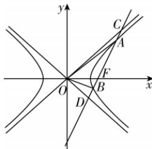

> [!faq]- 答案与解析
>
> > [!success]- **【答案】** 见解析
>
> > [!note]- **【解析】**
> > (1)设双曲线 $\frac{x^{2}}{a^{2}}-\frac{y^{2}}{b^{2}}=1$ 的焦距为2c，则c=2，双曲线的渐近线方程为 $bx\pm ay=0$ ，由题意知 $F(2,0)$ 到渐近线 $bx\pm ay=0$ 的距离为 $\frac{|2b|}{\sqrt{b^{2}+a^{2}}}=\sqrt{2}$ ，所以 $b=\sqrt{2}$ ，所以 $a=\sqrt{c^{2}-b^{2}}=\sqrt{2}$ ，故双曲线的方程为 $\frac{x^{2}}{2}-\frac{y^{2}}{2}=1$ 。
> > (2)(i)由题知直线x=ty+2过右焦点F，设 $A(x_{1},y_{1}),B(x_{2},y_{2})$ ，联立 $\left\{\begin{aligned}&x=ty+2,\\&x^{2}-y^{2}=2,\end{aligned}\right.$ 消去x整理得 $(t^{2}-1)y^{2}+4ty+2=0$ ，则 $\left\{\begin{aligned}&t^{2}-1\neq0,\\&\Delta=8t^{2}+8>0,\\&y_{1}+y_{2}=\frac{-4t}{t^{2}-1},\\&y_{1}y_{2}=\frac{2}{t^{2}-1}\end{aligned}\right.$ 因为直线与双曲线右支交于两点，所以 $y_{1}y_{2}=\frac{2}{t^{2}-1}<0$ ，所以-1<t<1，故实数t的取值范围为(-1,1).
> > (ii)由(i)知，-1<t<1， $|AB|=\sqrt{1+t^{2}}\cdot|y_{1}-y_{2}|=\sqrt{1+t^{2}}\sqrt{(y_{1}+y_{2})^{2}-4y_{1}y_{2}}=\frac{\sqrt{1+t^{2}}\sqrt{8t^{2}+8}}{1-t^{2}}$ 原点O到直线AB的距离 $d=\frac{2}{\sqrt{1+t^{2}}}$ .
> > 设 $C(x_{3},y_{3}),D(x_{4},y_{4})$ ，联立 $\left\{\begin{aligned}&x=ty+2,\\&x^{2}-y^{2}=0,\end{aligned}\right.$ 则 $(t^{2}-1)y^{2}+4ty+4=0$ ，
> > 则 $\Delta=16>0,y_{3}+y_{4}=\frac{-4t}{t^{2}-1},y_{3}y_{4}=\frac{4}{t^{2}-1}$ ，
> > 则 $|CD|=\sqrt{1+t^{2}}|y_{3}-y_{4}|=\sqrt{1+t^{2}}\cdot\sqrt{(y_{3}+y_{4})^{2}-4y_{3}y_{4}}=\frac{4\sqrt{1+t^{2}}}{1-t^{2}}.$ 而 $S_{1}+S_{2}=S_{\triangle COD}-S_{\triangle AOB}=\frac{1}{2}(|CD|-|AB|)d=\frac{4-2\sqrt{2t^{2}+2}}{1-t^{2}}$
> >
> > 令 $m=\sqrt{2t^{2}+2}\in[\sqrt{2},2)$ ，则 $S_{1}+S_{2}=\frac{4-2m}{1-\frac{m^{2}-2}{2}}=\frac{8-4m}{4-m^{2}}=\frac{4}{2+m}\leqslant\frac{4}{2+\sqrt{2}}=4-$ $2\sqrt{2}$ ，当 $m=\sqrt{2}$ ，即 t=0 时取等号.
> > 综上所述， $S_{1}+S_{2}$ 的最大值为 $4-2\sqrt{2}$ .
> >
> > 
