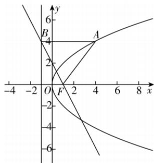

> [!faq]- 答案与解析
>
> > [!success]- **【答案】** C
>
> > [!note]- **【解析】**
> > 因为直线 BF 的方程为 $y = -2x + 2$ ，所以当 y = 0 时，x = 1，即 $\frac{p}{2} = 1$ ，所以抛物线 C 的方程为 $y^{2} = 4x$ ，准线方程为 x = -1，则 $B(-1, 4)$ ，由点 B 坐标得 $y_{A} = 4$ ，代入 $y^{2} = 4x$ ，得 $A(4, 4)$ .
> > 所以 $\left|AF\right|=\sqrt{(4-1)^{2}+(4-0)^{2}}=5.$ 故选 C.
> >
> > 
